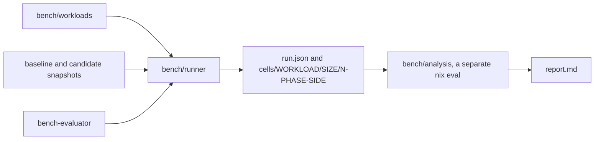

# Evaluation benchmarks

`lexicon-bench` compares a candidate revision with a baseline on fixed Nix workloads and reports,
per workload and size, how the pinned evaluator's deterministic counters moved. It reports deltas
only. Budgets and verdicts come with a calibration run.

```sh
lexicon-praxis bench --baseline d682ad2 --workloads '^subsystem\.'
```



## Commands

| Command | Does |
| --- | --- |
| `lexicon-bench compare --baseline REV --candidate REV\|worktree` | runs the schedule and writes records and `report.md` |
| `lexicon-bench report DIR` | renders `DIR/report.md` again from collected records |
| `lexicon-praxis bench [options]` | `compare --baseline main --candidate worktree`, later options override |
| `devenv tasks run lexicon:bench` | the praxis command with no extra options |

| `compare` option | Default |
| --- | --- |
| `--repo DIR` | the current directory |
| `--output DIR` | `$XDG_CACHE_HOME/lexicon-bench/TIME`, falling back to `~/.cache`; it must not exist |
| `--workloads REGEX` | every runnable workload; a bash regex over names |
| `--sizes "4 16 64"` | `4 16 64` |
| `--timeout SECONDS` | `600` per sample, enforced with `SIGKILL` |

`worktree` names the repository's working tree, copied without `.git`, `.runtime`, `.devenv`,
`.direnv`, `result*` or nested checkouts. A revision is fetched from the repository's git objects.

## Workloads

Every workload is Nix under `bench/workloads/`, calls only the flake's public `lib`, and projects a
finite value that both sides must produce identically. The catalog always comes from the candidate's
snapshot, and each side supplies its own `lib`.

| Workload | Size means | Projection |
| --- | --- | --- |
| `fleet.den` | hosts, each with two users, through Den v0.19.0 and Home Manager pinned by `fetchTree` hash | each host's furnish manifest destinations and each user's Home Manager file names |
| `fleet.plain` | declared limit | fails with `fleet.plain waits on the plain host, band 6` and never runs |
| `subsystem.ownerships.resolve` | selected units on one host | the resolved values |
| `subsystem.ownerships.fleet-resolve`, `fleet-prepared` | hosts, units and contexts | every context's selected values |
| `subsystem.ownerships.fleet-custom` | units on a custom axis | the merged values |
| `subsystem.ownerships.fleet-trace` | hosts and units | the value, every leaf's selection and the stage counts |
| `subsystem.ownerships.fleet-matrix` | hosts and units | selections, coverage, host differences and dead counts |
| `subsystem.registry.summary` | hosts | the summary |
| `subsystem.registry.queries` | hosts and users | usersOn, forSystem, hostsFor and homeFor per name |
| `subsystem.declarations.native` | Home Manager fields | the native imports |
| `subsystem.declarations.wide`, `dynamic` | extension entries, static or from a callback | every entry's value, default, metadata, origin and preparation |
| `subsystem.declarations.deep` | recursive levels | the same per level |
| `subsystem.declarations.prepared` | contexts over one prepared tree | the same per context |
| `subsystem.declarations.single`, `combined` | entries in a mixed-output block | Home Manager alone, or Home Manager and resource bridges |
| `subsystem.furnish.links` | external links | destinations |
| `subsystem.furnish.directory`, `shared` | directories, or user contexts over one | destination, representation and principal |
| `subsystem.furnish.grouped` | names under two roots | destinations |
| `subsystem.furnish.compile` | declarations | destination, target and executor |
| `subsystem.furnish.index` | declarations | host index keys |
| `subsystem.theme.matugen` | theme declarations | destinations and Matugen templates |
| `subsystem.toml.generate` | records | the document text `toml.render` returns |
| `subsystem.praxis.manifest` | commands | the whole manifest, with `bash` reduced to its program name |
| `subsystem.praxis.selected`, `diagnostics` | namespace commands | the selected manifest, reduced the same way, or every diagnostic code, path and the summary |

Inactive payloads, unrelated commands and unrequested callbacks throw, so a side that forces one
fails its sample. `skadi.live` isn't in the catalog.

No projection carries a store path, since its hash moves with changes unrelated to the code under
measurement. `subsystem.toml.generate` projects `toml.render`, the pure renderer `generate` writes
through, so nothing is built or read back. The executable's coreutils path is written as
`coreutils/bin/true`, and a praxis manifest's `bash` as `bash`.

## Runner

The runner is a `writeShellApplication` over coreutils, GNU time and git. It launches
`bench-evaluator`'s `nix` and nothing else.

Before launch it refuses, with exit 3, a dirty `worktree` baseline, a revision git can't resolve, an
existing output directory, and a candidate whose `packages.SYSTEM.bench-evaluator` isn't the
runner's evaluator. Both sides then run under that evaluator.

Each side resolves once to a locked store snapshot. Samples evaluate in pure mode against it, with
`NIX_SHOW_STATS=1`, `NIX_SHOW_STATS_PATH` and `NIX_COUNT_CALLS=1` set for the evaluator alone, under
`timeout --signal KILL`.

Each cell runs the schedule in `bench/runner/schedule.nix`, which the analysis also checks, and a
failed sample stops its cell:

| Order | Phase | Side |
| --- | --- | --- |
| 0, 1 | warmup | baseline, candidate |
| 2, 3 | measure | baseline, candidate |
| 4, 5 | measure | candidate, baseline |
| 6, 7 | measure | baseline, candidate |

A sample directory holds `meta.json`, `stats.json`, `output.json` (the projection, only after exit
zero), `stderr.log` and GNU time's `rss`. `meta.json` names the workload, size, order, phase, side,
exit, timeout, wall nanoseconds from launch to reap, peak RSS in KiB, machine, one-minute load at
launch, side snapshot, and the evaluator's version and out path. `run.json` names both sides'
specs, revisions, dirtiness, snapshots and narHashes, the catalog snapshot, the system, the
timeout and the evaluator.

## Analysis

`bench/analysis/report.nix` reads one run directory and renders it. The rules live in
`bench/analysis/default.nix` and are pure.

| Rule | Effect |
| --- | --- |
| records name more than one evaluator, or the baseline was dirty | the comparison is refused and the render throws |
| a sample timed out, exited nonzero, wrote no statistics or projection, lacks call counts, or its call counts don't sum to `nrFunctionCalls` | its cell is rejected, listing every such failure |
| a record misses a runner field | its cell is rejected as malformed |
| the schedule didn't run to the end in order | its cell is rejected |
| the projection differs within a side or between sides, checked only when no sample failed | its cell is rejected |
| a counter differs between one side's measured samples | the median is reported and marked nondeterministic |

Warm-up samples count toward rejection but never toward an aggregate.

| Counter | Source |
| --- | --- |
| `nrFunctionCalls`, `nrPrimOpCalls`, `nrThunks`, `nrOpUpdates`, `nrOpUpdateValuesCopied` | statistics |
| `values.number`, `envs.number`, `sets.number`, `list.elements`, `list.concats` | statistics |
| `heapBytes` | the sum of `values`, `envs`, `sets` and `list` bytes |
| applications per owner | `functions` counts summed by owner |

An owner is the directory of a lexicon or bench file relative to its snapshot, such as
`src/ownerships`. A fetched input is named by its reference without revision or narHash, such as
`github:feltfomo/krisis`. Another store path is `store:NAME`. Positions without a file are
`unpositioned`.

Wall time, evaluator CPU time, peak RSS and `gc.heapSize` are reported as medians per side and
never judged. Wall time and RSS include call counting, and a timed-out sample's RSS is the
`timeout` process's own.

## Limits

- No subsystem defines `markers.nix` yet, so the report has no marker entries or marker regions,
  and no profiler samples are taken.
- No budgets exist, so there are no verdicts and no `bench` gate.
- `fleet.plain` waits on the plain host, band 6.
- `skadi.live` isn't implemented.
