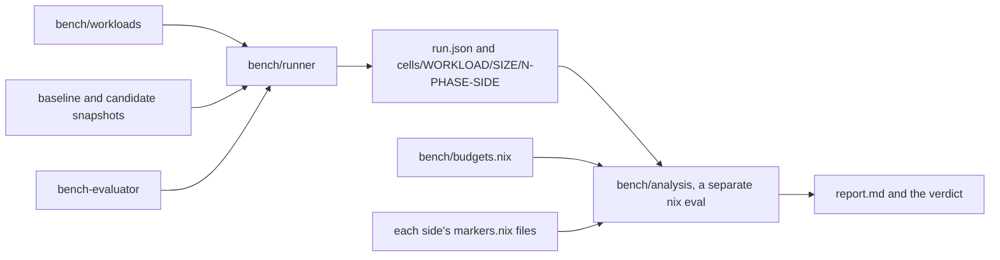

# Evaluation benchmarks

`lexicon-bench` compares a candidate revision with a baseline on fixed Nix workloads and reports,
per workload and size, how the pinned evaluator's deterministic counters moved, how often each
marked region was entered and how much sampled time it held. Counters are judged against the
calibrated budgets in `bench/budgets.nix`, and `lexicon:bench` fails when one regresses past its
budget.

```sh
lexicon-praxis bench --baseline d682ad2 --workloads '^subsystem\.'
```



## Commands

| Command | Does |
| --- | --- |
| `lexicon-bench compare --baseline REV --candidate REV\|worktree` | runs the schedule, writes records and `report.md`, exits with the verdict |
| `lexicon-bench report DIR` | renders `DIR/report.md` again from collected records and exits with the verdict |
| `lexicon-bench calibrate DIR...` | prints a `bench/budgets.nix` from runs that compared one revision with itself |
| `lexicon-bench reduce PROFILE [NAME...]` | prints the inclusive samples of each named frame in a folded profile, as `compare` records them |
| `lexicon-praxis bench [options]` | `compare --baseline main --candidate worktree`, later options override |
| `devenv tasks run lexicon:bench` | the praxis command with no extra options; the benchmark gate |

| Exit | Means |
| --- | --- |
| 0 | the verdict passed, or the candidate predates verdicts and the report only measures |
| 1 | a counter regressed past budget, the candidate failed a cell, or calibrated judgments are unavailable |
| 2 | usage |
| 3 | refused before launch |

| `compare` option | Default |
| --- | --- |
| `--repo DIR` | the current directory |
| `--output DIR` | `$XDG_CACHE_HOME/lexicon-bench/TIME`, falling back to `~/.cache`; it must not exist |
| `--workloads REGEX` | every runnable workload; a bash regex over names |
| `--sizes "4 16 64"` | `4 16 64` |
| `--timeout SECONDS` | `600` per sample, enforced with `SIGKILL` |

`worktree` names the repository's working tree, copied without `.git`, `.runtime`, `.devenv`,
`.direnv`, `result*` or nested checkouts. A revision is fetched from the repository's git objects.

## Workloads

Every workload is Nix under `bench/workloads/`, calls only the flake's public `lib`, and projects a
finite value that both sides must produce identically. The catalog always comes from the candidate's
snapshot, and each side supplies its own `lib`.

| Workload | Size means | Projection |
| --- | --- | --- |
| `fleet.den` | hosts, each with two users, through Den v0.19.0 and Home Manager pinned by `fetchTree` hash | each host's furnish manifest destinations and each user's Home Manager file names |
| `fleet.plain` | declared limit | fails with `fleet.plain waits on the plain host, band 6` and never runs |
| `subsystem.ownerships.resolve` | selected units on one host | the resolved values |
| `subsystem.ownerships.fleet-resolve`, `fleet-prepared` | hosts, units and contexts | every context's selected values |
| `subsystem.ownerships.fleet-custom` | units on a custom axis | the merged values |
| `subsystem.ownerships.fleet-trace` | hosts and units | the value, every leaf's selection and the stage counts |
| `subsystem.ownerships.fleet-matrix` | hosts and units | selections, coverage, host differences and dead counts |
| `subsystem.registry.summary` | hosts | the summary |
| `subsystem.registry.queries` | hosts and users | usersOn, forSystem, hostsFor and homeFor per name |
| `subsystem.declarations.native` | Home Manager fields | the native imports |
| `subsystem.declarations.wide`, `dynamic` | extension entries, static or from a callback | every entry's value, default, metadata, origin and preparation |
| `subsystem.declarations.deep` | recursive levels | the same per level |
| `subsystem.declarations.prepared` | contexts over one prepared tree | the same per context |
| `subsystem.declarations.single`, `combined` | entries in a mixed-output block | Home Manager alone, or Home Manager and resource bridges |
| `subsystem.furnish.links` | external links | destinations |
| `subsystem.furnish.directory`, `shared` | directories, or user contexts over one | destination, representation and principal |
| `subsystem.furnish.grouped` | names under two roots | destinations |
| `subsystem.furnish.compile` | declarations | destination, target and executor |
| `subsystem.furnish.index` | declarations | host index keys |
| `subsystem.theme.matugen` | theme declarations | destinations and Matugen templates |
| `subsystem.toml.generate` | records | the document text `toml.render` returns |
| `subsystem.praxis.manifest` | commands | the whole manifest, with `bash` reduced to its program name |
| `subsystem.praxis.selected`, `diagnostics` | namespace commands | the selected manifest, reduced the same way, or every diagnostic code, path and the summary |

Inactive payloads, unrelated commands and unrequested callbacks throw, so a side that forces one
fails its sample. `skadi.live` isn't in the catalog.

No projection carries a store path, since its hash moves with changes unrelated to the code under
measurement. `subsystem.toml.generate` projects `toml.render`, the pure renderer `generate` writes
through, so nothing is built or read back. The executable's coreutils path is written as
`coreutils/bin/true`, and a praxis manifest's `bash` as `bash`.


`tests.bench.workloads` checks every subsystem workload's projection at size 4 against a value
built from the size alone, so a workload is known to measure what its name says and not only to
agree with itself. `fleet.den` fetches Den and Home Manager, which the unit sandbox can't, so it has
no such case.

## Markers

A marker is an identity lambda defined alone on its line in its owner's `markers.nix`, applied at a
stage or kernel entry and never inside a per-element loop.

| Region | Applied at |
| --- | --- |
| `src/declarations.prepareDeclaration` | the result of `prepare`, once per declaration value and binding |
| `src/declarations.compileDeclaration` | `compile` of a prepared declaration, once per bridge call |
| `src/ownerships.resolveContext` | the per-context tail of a prepared resolver, once per context |
| `src/ownerships.mergeContributions` | the fold of a non-empty tracked merge, once per merge |
| `src/furnish.compileManifest` | `compile`, once per manifest |
| `src/furnish.indexCollisions` | the collision registry, once per index |
| `src/program.inventoryDirectory` | the walk of one valid static directory |
| `src/program/theme.composeThemes` | `themeFiles`, once per principal's theme entries |
| `src/praxis.compileProject` | the validated project, once per praxis invocation |
| `src/praxis.normalizeCommands` | the map of command results, once per praxis invocation |
| `src/toml.renderDocument` | the one rendering path behind `render` and `generate` |

Directory inventory is marked where its walk lives today, `src/program`, and moves with
`directories.nix` to Furnish in band 4. A region is `OWNER.NAME`, where the owner is the
directory holding `markers.nix`. The analysis finds every `markers.nix` in a side's snapshot,
skipping `tests`, `bench`, `docs`, `examples`, `verification` and hidden trees, and locates each
marker with `builtins.unsafeGetAttrPos` on that file. It stores no line numbers, so either side
can move a marker, and a region only one side defines is reported as baseline only or candidate
only. `tests.bench.markers` holds the invariant over the real tree: every marker is
`name = value: value;` at a position of its own, names are unique across owners, applying one
changes no value, and a throwing argument stays unforced until the result is demanded.

Entries are exact. They're the call counts at the marker's definition, so they come from the
measured samples. A marker forces only its argument to weak head normal form, and only when its
own result is demanded, so later demand on that value is outside the region.

Inclusive samples come from one profiling sample per side, which never counts. The profiler prints
a frame's call site and lambda name, not the definition, so a marker's frames are found by name.
That's why names are unique across owners, and a region is reported as ambiguous when the same
side's call counts show another applied lambda with the marker's name.

## Runner

The runner is a `writeShellApplication` over coreutils, gawk, gzip, GNU time and git. It launches
`bench-evaluator`'s `nix` and nothing else.

Before launch it refuses, with exit 3, a dirty `worktree` baseline, a revision git can't resolve, an
existing output directory, and a candidate whose `packages.SYSTEM.bench-evaluator` isn't the
runner's evaluator. Both sides then run under that evaluator.

Each side resolves once to a locked store snapshot. Samples evaluate in pure mode against it under
`timeout --signal KILL`. A counting sample sets `NIX_SHOW_STATS=1`, `NIX_SHOW_STATS_PATH` and
`NIX_COUNT_CALLS=1` for the evaluator alone and passes `--option eval-profiler disabled`. A
profiling sample clears those variables and passes `--option eval-profiler flamegraph` at 1000
samples a second, so the two modes never share a process even when the caller's environment sets
one.

Each cell runs the schedule in `bench/runner/schedule.nix`. The runner records it in `run.json`,
the analysis checks each cell against the recorded schedule, and a failed sample stops its cell:

| Order | Phase | Side |
| --- | --- | --- |
| 0, 1 | warmup | baseline, candidate |
| 2, 3 | measure | baseline, candidate |
| 4, 5 | measure | candidate, baseline |
| 6, 7 | measure | baseline, candidate |
| 8, 9 | profile | baseline, candidate |

A sample directory holds `meta.json`, `output.json` (the projection, only after exit zero),
`stderr.log` and GNU time's `rss`, plus `stats.json` for a counting sample or `profile.json` and
`profile.folded.gz` for a profiling one. `meta.json` names the workload, size, order, phase, side,
exit, timeout, wall nanoseconds from launch to reap, peak RSS in KiB, machine, one-minute load at
launch, side snapshot, and the evaluator's version and out path. `run.json` names both sides'
specs, revisions, dirtiness, snapshots and narHashes, the catalog snapshot, the system, the
timeout, the schedule, the profiling frequency and the evaluator.

A fleet's folded stacks reach hundreds of megabytes a sample, more than an evaluation should read,
so the runner reduces each profile with `reduce` before the analysis sees it. `profile.json` holds
the samples of every stack and, for each marker name the side defines, the samples of the stacks
holding a frame that ends in that name, once per stack however deep it recurses. The raw stacks
stay beside it compressed, for flame graphs. `checks.bench-reduce` pins the reduction.

The reduction rejects empty profiles, missing final newlines, nonpositive or malformed sample
counts, empty frames and noncanonical source positions. A bad reduction marks the sample failed
and retains `profile-error.log` beside the compressed raw profile, so later cells can still run.

## Analysis

`bench/analysis/report.nix` reads one run directory with `records.nix` and renders it. The rules
live in `bench/analysis/default.nix`, `statistics.nix`, `markers.nix` and `verdicts.nix` and are pure.

| Rule | Effect |
| --- | --- |
| records name more than one evaluator, or the baseline was dirty | the comparison is refused and the render throws |
| a sample timed out, exited nonzero or wrote no projection | its cell is rejected, listing every such failure |
| a counting sample wrote no statistics, lacks call counts, or its call counts don't sum to `nrFunctionCalls` | its cell is rejected |
| a profiling sample wrote no reduced profile | its cell is rejected |
| a record misses a runner field | its cell is rejected as malformed |
| a record's source, evaluator, workload, size, order, phase or side contradicts its run and cell | its cell is rejected before counters are read |
| statistics have malformed natural counts, function positions or allocation fields, or primop counts do not sum to `nrPrimOpCalls` | its cell is rejected |
| the schedule didn't run to the end in order | its cell is rejected |
| the projection differs within a side or between sides, checked only when no sample failed | its cell is rejected |
| a counter differs between one side's measured samples | the median is reported, marked nondeterministic and not judged |

Warm-up samples count toward rejection but never toward an aggregate.

| Counter | Source |
| --- | --- |
| `nrFunctionCalls`, `nrPrimOpCalls`, `nrThunks`, `nrOpUpdates`, `nrOpUpdateValuesCopied` | statistics |
| `values.number`, `envs.number`, `sets.number`, `list.elements`, `list.concats` | statistics |
| `heapBytes` | the sum of `values`, `envs`, `sets` and `list` bytes |
| applications per owner | `functions` counts summed by owner |
| entries per marker | `functions` counts at the marker's definition |

An owner is the directory of a lexicon or bench file relative to its snapshot, such as
`src/ownerships`. A fetched input is named by its reference without revision or narHash, such as
`github:feltfomo/krisis`. Another store path is `store:NAME`. Positions without a file are
`unpositioned`.

Wall time, evaluator CPU time, peak RSS, `gc.heapSize` and marker samples are reported and never
judged. Wall time and RSS include call counting, and a timed-out sample's RSS is the `timeout`
process's own.

## Verdicts

Each of the eleven counters of an accepted cell gets a verdict against its budget in
`bench/budgets.nix`. A counter regresses when it rises by at least the budget's absolute floor and
by more than its relative tolerance in permille, both together, the joint rule nix-effects' bench
uses. The same move downward is an improvement, anything smaller is within budget, and a
nondeterministic counter is unjudged. Budgets missing any aggregate counter cannot judge the run.
Owner applications and marker entries are reported beside the counters and never judged, since
moving code between owners or adding a marker isn't a cost regression. Verdicts compare the exact
counter ratio, independently of the integer permille displayed in the report.

| Run | Verdict |
| --- | --- |
| a counter regressed in some cell | fail |
| a cell was rejected because a candidate sample failed or its projection moved within the candidate | fail |
| a cell was rejected only for the baseline's sake, or because the two sides project different values | unjudged, listed, doesn't fail |
| the budgets were calibrated on a different evaluator version | no verdicts; `compare` and `report` exit 1 until a recalibration lands |
| budgets miss a counter, or no accepted cell has a deterministic counter | no verdicts; `compare` and `report` exit 1 |
| otherwise | pass |

A baseline that predates a workload's API, such as `toml.render` before it existed, fails its own
samples, and that cell is unjudged rather than failing the candidate.

## Calibration

The budgets use two retained lumi runs from 2026-10-28, both comparing clean revision
`339c3a8872f51facba1ba0b623124c464589881d` with itself. Both sides name source
`/nix/store/3v18a7dp0gx7q081r8qdx5adgf5iby1b-source`, with narHash
`sha256-6wKpRo28tNPbXJvz1ijTBdaNBhKkRlyme03sLN7B8+A=`, and evaluator 2.34.8 at
`/nix/store/hxxgpmyg1g2z1jy063n4fbzvm4y9mk0l-nix-2.34.8`.

The first run covers all 27 runnable workloads at sizes 4, 16 and 64, giving 81 cells. The second
covers the 26 subsystem workloads at those sizes, giving 78 cells. Each cell has one warmup per
side and three alternating measured pairs. All 159 cells passed source, metadata, statistics and
projection validation. All eleven aggregate counters were deterministic and identical between
sides. The runs predate separate profiling samples, so their recorded eight-sample schedules are
used as authored; profiling contributes no gated counters.

Each budget is twice the largest observed absolute and relative move, rounded outward, or its
policy floor if larger. These runs observed zero noise, so the policy floors decide every budget.
The relative floors and the count floor follow nix-effects' benchmark allocation policy. The
heap-byte floor is Lexicon's policy. They are tolerances for accepted changes, not measured noise.

| Counters | Relative floor | Absolute floor |
| --- | --- | --- |
| the ten count counters | 5‰ | 2,000 counts |
| `heapBytes` | 50‰ | 65,536 bytes |

`lexicon-bench calibrate DIR...` checks every comparison before generating budgets. Both sides of
each run must be clean and have the same revision and content hash. Runs must name one evaluator
version and store path, contain no rejected cells, and provide at least one deterministic
observation for each counter. A counter's nondeterministic cells are recorded and excluded from
its noise estimate. Another calibration is required when the evaluator version changes.

## Evaluator behavior

These are properties of CppNix 2.34.8 that the runner and analysis rely on. They were established
by the measurement tools this suite replaced and hold for `bench-evaluator` at this lock.

- `functions` in the statistics counts lambda applications by the lambda's definition position,
  one per applied argument, and `primops` counts calls by name. Their sums equal
  `nrFunctionCalls` and `nrPrimOpCalls`. `line` and `column` appear together and only for a
  positioned lambda, and `file` only for a path origin.
- `attributes` is always null, because the evaluator fills a copy of the list, so attribute
  selection counts aren't available.
- The evaluator runs a full collection before writing statistics, and the call maps allocate, so a
  counting sample's wall time and RSS include both.
- A folded profile line is `frame;frame count`. A lambda frame prints a position and the lambda's
  name, and the position is normally the call site; when the call site's origin doesn't resolve it
  prints the definition instead. A primop frame prints `primop NAME`.
- The profiler only samples when a function is entered and at least one period has passed since its
  last sample, so time in a primop or a thunk that enters no function goes to the next stack
  entered. Samples locate observed execution, not exact cost.
- `SIGTERM` only sets an interrupt flag that 2.34.8 checks outside the evaluation loop, so a
  terminated evaluator can keep running. The runner's limit is `SIGKILL`, after which no
  statistics are written and a profile keeps only what its periodic flushes wrote.

## Marker overhead

`fleet.den` with and without markers, run on lumi on 2026-10-28 with the baseline at 339c3a8 and
the candidate this change's working tree, whose only `src` change is the markers. Counters are
medians of three measured samples per side, and every counter was deterministic.

| Hosts | Marker entries | `nrFunctionCalls` | `nrThunks` | `envs.number` | `values.number` | `nrPrimOpCalls` | `sets.number` | `heapBytes` |
| --- | --- | --- | --- | --- | --- | --- | --- | --- |
| 4 | 222 | 6,031,617 → +222 | 9,412,482 → +240 | 7,059,035 → +222 | 19,075,787 → +245 | 2,894,597 → +9 | 2,402,161 → +5 | 980,399,840 → +7,800 |
| 16 | 870 | 23,585,295 → +870 | 36,817,668 → +900 | 27,591,335 → +870 | 75,116,873 → +905 | 11,281,949 → +21 | 9,434,881 → +5 | 3,861,304,752 → +28,824 |
| 64 | 3,462 | 94,239,207 → +3,462 | 146,549,292 → +3,540 | 110,253,335 → +3,462 | 299,412,257 → +3,545 | 44,877,437 → +69 | 37,591,681 → +5 | 15,417,009,424 → +112,920 |

The function-call delta equals the marker entries at every size, so a marker costs one
application and one environment per entry, as the contract says, plus about one thunk for its
argument. The rest is importing the `markers.nix` files: one set each, and one `import` call each
time an owner's file is instantiated, which Furnish does per host. Every delta is under 0.04‰, far
inside any budget. List, update and copy counters didn't move.

| Hosts | 4 | 16 | 64 |
| --- | --- | --- | --- |
| `src/ownerships.resolveContext` | 96 | 384 | 1,536 |
| `src/ownerships.mergeContributions` | 84 | 324 | 1,284 |
| `src/declarations.compileDeclaration` | 24 | 96 | 384 |
| `src/program/theme.composeThemes` | 8 | 32 | 128 |
| `src/furnish.compileManifest` | 4 | 16 | 64 |
| `src/furnish.indexCollisions` | 4 | 16 | 64 |
| `src/declarations.prepareDeclaration` | 1 | 1 | 1 |
| `src/program.inventoryDirectory` | 1 | 1 | 1 |

Entries grow with hosts and not with anything finer, which is the stage-entry rule holding. The
declaration is prepared once and its directory walked once for the whole fleet, the shared static
preparation the architecture requires. Of 91,250 profiler samples at 64 hosts,
`compileDeclaration` held 580, `compileManifest` 530 and `indexCollisions` 332; the regions that
return a lazy record, such as `resolveContext`, hold almost none, since the work happens after
they return.

## Limits

- Verdicts judge the eleven counters only. Owner applications and marker entries are reported
  and never judged.
- A marker's inclusive samples cover the weak head normal form of its argument. A region that
  returns a lazy record, such as `src/ownerships.resolveContext`, holds few samples however much
  later work its value causes.
- The profile reduction is shell, in the runner, because the analysis can't read a fleet's raw
  stacks. It only counts frames by name, and the analysis decides what they mean.
- Directory inventory is marked in `src/program` until its walk moves to Furnish.
- `tests.bench.workloads` has no case for `fleet.den`, whose inputs need the network.
- `fleet.plain` waits on the plain host, band 6.
- `skadi.live` isn't implemented.
