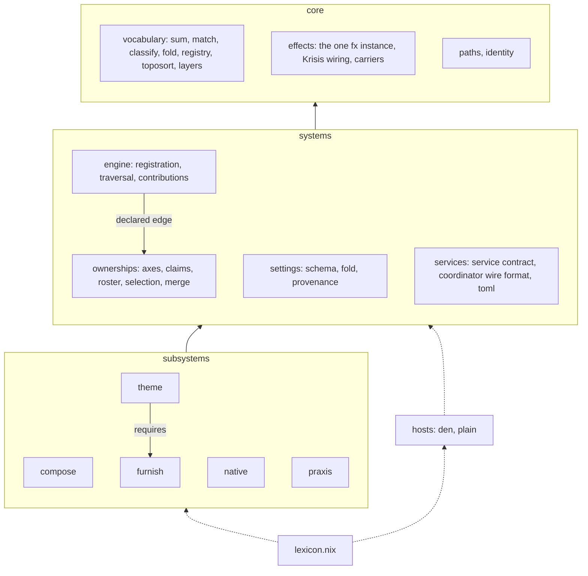
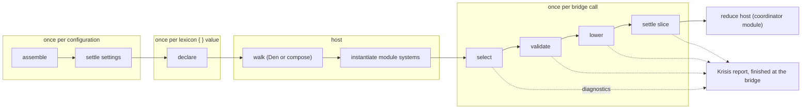
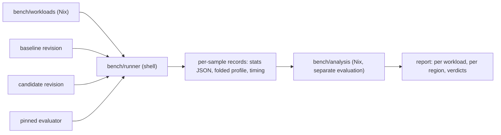

# Lexicon architecture

Lexicon compiles small declarations into native modules and runtime plans. This page is the map an
engineer uses before changing it: who owns what, how a declaration moves through the compiler, what
each step may force, where extensions plug in, which invariants hold it together, and how it fails.
[The spec](../reference/capabilities.md) states what consumers get. [The audit](../records/restructure-audit.md) holds the evidence; this page
cites it as `audit:<section>` and keeps only what the audit supports.

Everything here is an **accepted target**, approved by the owner on 2026-10-27, unless marked
**Current** (the tree does it today). Every accepted target names the band that builds it on
[the effort page](../efforts/restructure.md), through the spec's status column; nothing here is
deferred or conditional. Statements inferred rather than read in source are marked **Assumption**.

## Purpose and boundaries

Lexicon owns declaration vocabulary, ownership selection, the compile pipeline, subsystem assembly,
static settings, the portable aspect model for the plain host, and the plans Furnish, theme and
Praxis services execute. It protects one outcome: a consumer writes a small declaration and every
concern behind it has one owner.

It doesn't own:

- diagnostics records, collection, rendering or policy (Krisis);
- the effect runtime (nix-effects, vendored and qualified by Krisis);
- composition under Den (Den walks, batteries, quirks, policies);
- native module merging (the NixOS and Home Manager module systems);
- filesystem reconciliation and theme publication at runtime (the coordinator and publishers);
- the consumer's fleet (skadi and any other flake).

Evaluation is pure Nix. Anything that executes, locks, writes or reloads happens in a runtime
service outside evaluation.

## Layers



| Layer | May import | Must not |
| --- | --- | --- |
| core | Nix builtins, nixpkgs `lib`, nix-effects stable API through Krisis's qualified source, Krisis | name a subsystem or host; read the filesystem; emit diagnostics except programmer-error throws |
| systems | core; another system only through a declared edge | import a subsystem or a host |
| subsystems | core, systems, and `requires.<name>.exports` for names in their declared closure | import another subsystem's files by path |
| hosts | core, systems, the host contract, values the assembly hands them | import a subsystem; the assembly passes the plain host its walker |
| assembly (`lexicon.nix`, `flake.nix`) | everything | contain domain logic |

Declared edges: `engine -> ownerships` (traversal applies claims). Subsystem edges are the
`requires` lists: `theme -> furnish` today. `compose` requires nothing, because class names come
from the engine's class registry, which `native` fills. Settings reach a stage as an argument from
the assembly, so `engine` has no edge to `settings`.

Enforced by `tests/architecture/layers.nix`, a nix-unit case that reads every `.nix` file under
`core/`, `systems/`, `subsystems/` and `hosts/` with `builtins.readFile`, extracts import paths, and
checks each against this table, the declared edges and every record's `requires`. That's ordinary
evaluation over tracked source, not import-from-derivation.

## Ownership by target path

| Path | Owns |
| --- | --- |
| `lexicon.nix` | Assembly: records into the `Environment`, public `lib`, aliases mounted from `legacy/` and `hosts/` |
| `core/effects.nix` | The constructor for one nix-effects instance and native Krisis. `flake.nix` applies it once for the default environment; `configure { lib }` applies it once per environment |
| `core/vocabulary.nix` | `sum`, `match`, `classify` |
| `core/fold.nix` | `fold`, `foldWith` over node descriptions |
| `core/registry.nix` | collision-checked registries and `dispatch` |
| `core/order.nix` | `toposort`, `closure` |
| `core/layers.nix` | `foldLayers` and the merge strategies |
| `core/paths.nix` | structured authored paths, normalized path refinements, conversion to Krisis segments |
| `core/identity.nix` | canonical names and identity keys formerly from Axiom |
| `systems/engine/` | node constructors, registration, traversal, contribution envelopes, the class and plan registries, the engine catalog |
| `systems/ownerships/` | axes as algebras, descriptors, roster, selection kernel, merge kernel, inspection matrix |
| `systems/settings/` | schema leaves, layer fold, provenance, the settings reference generator, and `edge.nix`, the module-system edge adapter for host-bound leaves |
| `systems/services/contract.nix` | the service record shape |
| `systems/services/coordinator/` | the coordinator's wire contract (manifest, ledger, executors, strategies) and package binding |
| `systems/services/render/registry.nix` | the file-source format registry and the format record shape |
| `systems/services/render/toml/` | TOML encoder, renderer and Nix-side validator; the build-time merge and runtime publisher (`publisher.py`) |
| `systems/services/render/json/` | JSON encoder and pretty-printer, both Nix |
| `subsystems/native/` | `package`, `homeManager` and `nixos` blocks, the ownership-unit adapter, the `nixos` and `homeManager` class registrations |
| `subsystems/furnish/` | files, directories, links, lifecycle, the slice settle stage, and `services/coordinator.nix`, the NixOS module that compiles a host's declarations and holds the collision index |
| `subsystems/theme/` | theme block, adapters as a registry, composition, matugen and composition runtime services |
| `subsystems/praxis/` | the command compiler, `surfaces.praxis`, the Rust runtime as a service |
| `subsystems/compose/` | the portable aspect model, the plain walker, the module-file merge, the quirk registry and collection (`quirks.nix`), batteries for the plain host, fleet declarations (`lib.registry`) |
| `hosts/den/` | roster, principals, `mkTarget`, `hostAspects`, `drop`, the Den bridge |
| `hosts/plain/` | entity kinds, principals, `nixosSystem` instantiation |
| `legacy/` | `program*` translation and old-extension conversion, removed in a reviewed change |
| `tests/` | nix-unit cases mirroring the tree; system tests under `tests/system/` |
| `bench/` | the evaluation benchmark suite |

One concern, one owner. Two places that decide the same thing are a defect in one of them.

## The compile pipeline

The proposal's single pipeline from walk to emit doesn't match where work runs (audit: forDen and
the bridges; plan settle order). Lexicon's compile path runs inside the class module functions a
host receives, and the only place two declarations meet is the coordinator module after the module
system merges them. So the pipeline has four lifetimes.



| # | Stage | Owner | Input | Output | May force | Must not force |
| --- | --- | --- | --- | --- | --- | --- |
| 0 | assemble | `lexicon.nix` | subsystem records, configure arguments | `Environment` | record `name`, `requires`, vocabulary names, catalog code keys, settings schema structure and strategy tags | `lower`, node bodies past constructor tags, services, surfaces, batteries |
| 1 | settle settings | `systems/settings` | schemas, ordered layers | `Settings { value; explain; }` | leaf presence per layer; values of the winning `replace` layer and of every contribution to `append`/`union`/`attrs`/custom leaves, when demanded | shadowed `replace` values, provenance entries until read |
| 2 | declare | `systems/engine` | one authored declaration | aspect fragment `{ name?; includes?; nixos?; homeManager?; }` with shared static preparation bound lazily | declaration attr names, annotation values, immediate container shapes, static-vs-callback discrimination, block `resourceIntent` | domain fields, native bodies, sources, callbacks |
| 3 | walk | Den, or `subsystems/compose` | aspect roots, host kinds, context | class modules per entity | aspect `name`, `includes` spine, `builtins.functionArgs` of bodies, context keys bodies request | class payloads, which includes every Lexicon bridge |
| 4 | select | engine over the ownerships kernel | prepared tree, slice context, requested output | `Selected` with `origins`, `metadata`, `prepared` | claims, roster entries, context keys registered axes request; callbacks of selected nodes for the requested projection | inactive branches, unrequested projections, callbacks of unselected nodes |
| 5 | validate | engine with Krisis `T` | `Selected` | `Checked Valid` | selected domain fields to the depth their type requires | `T.Any` fields, native payloads |
| 6 | lower | each block's kernel, wrapped by the engine's envelope check | valid value, block settings, prepared | `Contributions { classes; plans; }` | whatever that block's `lower` demands | other blocks |
| 7 | settle slice | `subsystems/furnish` with theme's plan kind | this slice's plans, principals | native modules plus `lexicon.furnish.declarations` entries for each principal, with format sources rendered to `writeText` derivations | theme fields of selected theme plans, inventories of selected directories, each selected `source` to weak head normal form and a format source's value when its derivation is demanded | sources that need no inventory, other slices |
| 8 | reduce host | `subsystems/furnish/services/coordinator.nix` | the merged `lexicon.furnish.declarations` of one host | manifest, collision verdict | destinations and identities of every declaration on the host | file contents, generated sources (retained as derivations) |

Stage 2 is today's `bound.prepare raw` (`src/lexicon/default.nix:113`). Stages 4 to 7 are today's
`prepared.compile` and `resources.compose` per bridge (`src/lexicon/default.nix:134-197`,
`src/lexicon/resources.nix:187-225`). Stage 8 is Current in `src/furnish/runtime.nix:68-75`.

Contribution shape: `{ classes = { <class> = [ { module; origin; } ]; }; plans = [ Plan ]; }`, with
`Plan` a tagged sum over registered plan kinds. Today's closed `{ nixos; homeManager; resources; }`
is one projection of it, so the built-in bridges keep their behavior.

Settle order inside stage 7 is the topological order of plan kinds' `after` lists, computed once at
assembly. Today that's one edge, `theme` before `directory` (directory expansion reads normalized
themes). File and link plans have no dependency on directories; their output order stays file plans
then directory files (audit: plan settle order). Contextual callbacks, the dynamic part, ran in
stage 4, so no plan needs dynamic scheduling.

Diagnostics: each stage returns `Computation (Checked a)`. Independent checks combine with
`validation.all` or `validation.allAttrs` and accumulate. Dependent work uses `validation.andThen`.
Each bridge call runs one Krisis report and finishes it with `report.finish` at the expression the
module system forces (D3). No stage serializes or deep-forces its output to pass it on.

## Lifetimes

| Lifetime | Created by | Holds | Ends |
| --- | --- | --- | --- |
| Configuration | `configure`, or the default configuration built once in `flake.nix` | `Environment`, `Settings`, registries, catalog, the bound `lexicon` function | with the flake evaluation |
| Declaration | `lexicon { ... }` | the authored value and its shared static preparation, including directory inventories of static directories | when no aspect references it |
| Host evaluation | the host instantiating a module system | merged options, the coordinator module's collision index and manifest | with that `nixosSystem` |
| Slice | one bridge call with one `(host, user, output)` | the Krisis report, callback results, slice preparation of callback-produced records | when the module value is forced |
| Runtime | activation, boot or user action | coordinator ledger, theme publication state | outside evaluation |

Static preparation lives at declaration lifetime and is shared by every slice. Preparation of
callback-produced records lives at slice lifetime. Nothing in a slice survives into another slice.

## Extension points

| Point | Contract | Registered in |
| --- | --- | --- |
| Subsystem record | the fields below | `configure { subsystems }` |
| Block | `definitions.md`, with field shapes as Krisis types | `blocks` |
| Ownership descriptor, relation, metadata key | `definitions.md` ownership section | `annotations` |
| Native class | `{ name; scope; }` where scope is `user` or `system` | `classes` |
| Plan kind | `{ kind; type; settle; after ? [ ]; }` | `plans` |
| Service | `{ name; module ? null; package ? null; consumes; }`; hosts attach `module` to every host that has the subsystem enabled | `services` |
| Surface | a function mounted at `lib.<name>` or `lib.<name>.<surface>` | `surfaces` |
| Battery | aspect value or aspect function, portable subset only | `batteries` |
| Host | the host contract below | `hosts/` |
| Benchmark marker | identity lambda in the owner's `markers.nix` | the owner's directory |
| Quirk | `{ name; doc; }`; aspects emit on the key, class modules receive the scope's list | `quirks` in a record, or a plain-host module file's `quirks` |
| File-source format | `{ name; type; render; publisher ? null; }` where `render` is a Nix kernel from a valid value to text | `formats` in a record |

Subsystem record fields, all lazy: `name` (kebab-case), `requires`, `settings`, `blocks`,
`annotations`, `classes`, `plans`, `services`, `surfaces`, `batteries`, `quirks`, `formats`,
`exports`, `catalog`, `docs`. The toolkit is `{ lib, core, T, setting, node, ownerships, catalog, requires }`. Third
parties and built-ins get the same toolkit.

Host contract:

```nix
{
  name; # "den" or "plain"
  kinds; # entity kind forest, e.g. { host = { }; user = { parent = "host"; }; }
  roster; # Ownerships roster from the host's entities
  principals = { files; userNames; }; # today's filePrincipals and hostUserNames
  classes; # { <class> = { kind; }; } where each class lands
  settingsModule; # the edge adapter's NixOS module for this environment, attached to every host
  quirks; # quirk names the host registers; the Den host reads them from `den.quirks`
}
```

The Den host doesn't walk; Den does. The plain host receives `compose.exports.walk` from the
assembly.

### The aspect model and `lexicon { }`

`lexicon { ... }` is a function from a declaration to an aspect fragment in every host. It passes
`name` and `includes` through and compiles the declaration's blocks into the class keys `nixos` and
`homeManager`, whose values are the bridge module functions. The walker therefore sees one meaning
of `nixos`: a native module. Lexicon's ownership-unit `nixos` field exists only inside the
declaration and never reaches a walker (audit: lead claim 3).

The portable aspect subset is: an attrset of `name`, `includes`, `description` and registered class
keys; or a function whose formal arguments are entity kinds, optionally with `...`, returning such
an attrset. `includes` is a DAG. Class payloads are native modules and stay opaque; arguments named
after entity kinds are pre-applied in flat form and the rest are advertised with
`lib.setFunctionArgs`, as Den does (`D/nix/lib/aspects/fx/class-module.nix:106-118`). Dedup is by
`scope/identity`, where identity is the name chain plus context id, matching Den's key
(`D/nix/lib/aspects/fx/handlers/check-dedup.nix:17-23`). Unnamed includes never dedup. The plain
walker reproduces Den v0.19.0's include order on the portable subset, whatever that order is; S2 is
the first conformance fixture band 6 writes, and its result fixes the walker's order rather than
gating anything. `lexicon { }` passes through `name`, `includes` (P1) and the host's registered
quirk keys; a pass-through key colliding with a block or annotation name fails when the host is
bound.

### The plain host

Accepted target (D2). It's the smallest model that reads like skadi's Den files without Den. Owners:
`hosts/plain/` for instantiation, `subsystems/compose/` for the module-file merge, the walker and
batteries.

Signature, mounted as `lib.flake` for the default environment and `(configure { ... }).flake` for a
configured one:

```nix
flake { inputs; modules; } -> { nixosConfigurations; lexicon = { aspects; hosts; roster; trace; }; }
```

`inputs` must contain `nixpkgs`; `home-manager` is required only when some user has Home Manager
content, and its absence then fails at walk naming the user and host. Settings and extra subsystems
come only from `configure`. The result is an attrset the consumer returns or merges into other
outputs with `//`.

A module file is a path, a function or an attrset. A path is imported. A function is called with
`{ inputs, lib, lexicon, aspects, batteries }`, where `lexicon` is the bound declaration function,
`aspects` the merged aspect set and `batteries` the compose batteries. The value has only the keys
`aspects`, `hosts` and `default`; any other key fails naming the file.

Merging. `aspects` from all files go through `core.registry` keyed by name, and `hosts` likewise; a
name defined in two files fails naming both. `default` lists concatenate in `modules` order. The
merged `aspects` is a lazy fixpoint passed back to every file, so `includes = [ aspects.wayland ]`
works across files. The registry forces only each file's attribute names, so a file's key set must
not depend on `aspects`; a file that computes its keys from `aspects` recurses infinitely, as
`builtins.attrNames` of a fixpoint would.

Hosts and users:

```nix
hosts.khion = {
  system = "x86_64-linux";
  users.feltfomo = { }; # optional userName, home
};
```

Entity records are `host = { name; system; id = "${system}/${name}"; }` and
`user = { name; userName ? name; home ? "/home/${userName}"; }`, the shapes today's bridges and
`principalFor` already read (`src/lexicon/default.nix:202-208`). The roster comes from the same
builder the Den host uses (`src/den.nix:185-211`), moved to `systems/ownerships/roster.nix` and fed
an entity list: one `define.host` per host with its system, one `define.user` per user naming its
canonical host. `filePrincipals` gives one user principal per (host, user) slice and
`hostUserNames` lists `hosts.<h>.users`.

Aspects attach by name as in Den: the host's root is `aspects.<host name>` and each user's root is
`aspects.<user name>`; a missing one is an empty aspect. `default` aspects are included at every host
scope and every user scope, the role `den.default` plays in `/etc/skadi/modules/den.nix:19-20`. Kinds
are `host` with child `user`. Classes land by kind: `nixos` content from a host or one of its users
lands in that host's `nixosSystem`; `homeManager` content from a user lands in
`home-manager.users.<userName>`; `homeManager` content at host scope fans out to each user, as a
host-scope `{ user, ... }` body does in Den (`parametric.mdx:56-60`). A `default` aspect's class
content follows the same landing rule as any aspect, so its `nixos` content walked at a user scope
lands on the host again; that matches Den only if Den does the same, and the conformance fixture for
`default` fixes the plain walker to Den's observed behavior in band 6.

Instantiation, per host:

```nix
inputs.nixpkgs.lib.nixosSystem {
  modules = [
    { nixpkgs.hostPlatform = host.system; networking.hostName = lib.mkDefault host.name; }
    inputs.home-manager.nixosModules.home-manager # only when a user has homeManager content
  ]
  ++ hostClassModules
  ++ serviceModules # every enabled subsystem's `services.*.module`, inert until enabled
  ++ map (u: { home-manager.users.${u.userName}.imports = userClassModules u; }) users;
}
```

Class modules are pre-applied in flat form with `host` and `user`, which is what Lexicon's bridges
declare (`host ? null, user ? null`). No `specialArgs` are added; a module that needs `inputs`
closes over its file's `inputs` argument.

Batteries on day one, as portable aspect functions of `{ host, user }`: `define-user`
(`users.users.<userName>` with `isNormalUser` and `home`, plus Home Manager `home.username` and
`home.homeDirectory`), `primary-user` (`wheel` and `networkmanager` groups) and `user-shell shell`
(enables the shell for the system and the user and sets the login shell). skadi's users include
exactly these three (`/etc/skadi/modules/users/feltfomo.nix:8-10`, `owner.nix:5-6`,
`grandpa.nix:6`), and a standalone flake can't define a usable user without the first. Hostname is
built into instantiation rather than a battery. Den's other batteries (`hjem`, `maid`, `wsl`,
`tty-autologin` and the rest) aren't shipped until a consumer needs one.

Left out, and listed in the spec's "What Lexicon doesn't do": installer targets and `drop` for the
plain host, `excludes`, policies, pipes, `provides`. `trace` records inert bodies with their scope
(D5).

### Quirks

Accepted target, band 6 (D10). The smallest equivalent of Den's same-scope quirk collection, the
only quirk use in skadi: host-scope aspects emit `persistence.directories` and one `nixos` module
takes `persistence` as an argument (`/etc/skadi/modules/den.nix:16`, `system/networking.nix:3`,
`desktop/display-managers/sddm.nix:3`, `system/impermanence.nix:10,18`). No skadi code uses a pipe.

| Concern | Rule |
| --- | --- |
| Registration | A quirk is `{ name; doc; }`, registered by a plain-host module file's `quirks` key (fleet vocabulary, like skadi's `den.quirks.persistence`) or a subsystem record's `quirks` field (library vocabulary). One registry in `subsystems/compose/quirks.nix`, built with `core.registry`; a name colliding with another quirk, a class, a structural aspect key (`name`, `includes`, `description`) or a module argument (`config`, `options`, `pkgs`, `lib`, `modulesPath`, `host`, `user`) fails naming both origins |
| Emission | An aspect sets the quirk's key to any value. A list value contributes its elements; any other value contributes itself (Den's flattening, `D/nix/lib/aspects/fx/assemble-pipes.nix:17-26`) |
| Aggregation | One pool per entity scope (each host, each user). A value lands in the pool of the scope where its aspect is walked. Pools never cross scopes |
| Delivery | A class module whose formal arguments name a quirk receives its scope's pool, pre-applied in flat form with `host` and `user`; an empty pool is `[ ]` |
| Order | Pool order is walk order after dedup, so a deduplicated aspect contributes once. A consumer sees every producer in its scope wherever it sits in `includes`, because pools are computed from the finished walk |
| Laziness | Classification forces only aspect attribute names. A pool is built when a consumer demands it; flattening forces each value to weak head normal form then, and no element further |
| Den host | Den's quirks keep working unchanged. `hosts.den` reads the registered names with `builtins.attrNames den.quirks`, so `lexicon { }` can pass them through; Lexicon never collects under Den |
| Conformance | `tests/subsystems/compose/conformance.nix` runs a skadi-shaped persistence fixture, with the consumer listed before its producers, through Den v0.19.0 and the plain walker and compares the delivered pools |

### File-source formats

Accepted target, band 7 (P4 and the JSON addition). A Furnish file `source` is classified with K2:
a path, a string, a derivation, or a one-key record whose key is a registered format. Formats live in
one registry, `systems/services/render/registry.nix`, so TOML and JSON are two entries, not two
special cases. A format record is `{ name; type; render; publisher ? null; }`: `type` is the Krisis
type of an admissible value, `render` a Nix kernel from a valid value to text, and `publisher` the
runtime merge service if the format has one. Stage 7 renders a format source to
`pkgs.writeText <destination basename> text` with the host's `pkgs`; nothing else runs.

| Format | Render | Validation | Runtime publisher |
| --- | --- | --- | --- |
| `toml` | today's `src/toml/render.nix` fragments, joined once | parse the output back with `builtins.fromTOML` and compare with the input; each `literal` fragment is checked against TOML 1.0's value grammar with `builtins.match`, because both pinned evaluators reject TOML dates and times in `fromTOML` (evaluated on Lix 2.95.4 and CppNix 2.34.8) | the existing publisher, for theme composition merges |
| `json` | a Nix pretty-printer: two-space indentation, keys in Nix's sorted order, a trailing newline; every scalar is written with `builtins.toJSON`, so escaping and float spelling are the evaluator's own (identical on Lix 2.95.4 and CppNix 2.34.8 for the probes `0.1`, `1e+20`, `1e-07`, `1/3`, evaluated) | admissibility by `type`: null, booleans, integers, floats, strings (context kept), lists and attrsets; functions, paths and derivations are rejected at their path | none: no consumer merges JSON at runtime; theme composition rejects a JSON output with `theme/merge-unsupported-format` |

The pretty-printer over `builtins.toJSON` beats bare `builtins.toJSON`, which writes one line, and
beats `pkgs.formats.json`, which runs `jq` in a build. Managed and writable JSON files are read and
diffed by people, and the printer only lays out structure while the evaluator owns every scalar's
bytes. Its cost is one fragment list per value, joined once.

TOML parity is band 7's verification, not a gate. It's defined over the renderer's output grammar,
which Lexicon controls (D17): for every fixture under `tests/toml/` on both evaluators, the Nix
validator accepts exactly the documents today's Python validator accepts, with equal parsed values. A difference is fixed in the renderer or the validator in that band. The check is
`checks.<system>.toml-parity`, which evaluates the fixture set with `pkgs.lix` and
`bench-evaluator` inside one build and compares their results in Nix.

Catalog codes: `toml/unsupported-value`, `toml/invalid-literal`, `toml/round-trip`,
`json/unsupported-value`, `furnish/source-format-unknown`, `furnish/source-shape`,
`theme/merge-unsupported-format`.

## Settings

A leaf is `setting { type; default; merge ? "replace"; doc; }`. `type` is a Krisis type; `default`
is lazy. Layers are `{ origin; value; }`, least specific first: schema defaults (origin from
`path.fromAttrPos` on the record), then the `configure` layer. The fold is one pass per leaf:

| Strategy | Operation | Law | Forces |
| --- | --- | --- | --- |
| `replace` | last present wins | associative, not commutative | only the winning value |
| `append` | concatenation in layer order | monoid, identity `[ ]` | every contribution, when demanded |
| `union` | ordered union, first occurrence kept | associative, idempotent | every contribution, when demanded |
| `attrs` | per-key `replace` | pointwise last | keys, and each key's winning value when demanded |
| `{ custom = { name; op; }; }` | `op` folded left to right | none assumed; never reassociated | as `op` demands |

`explain.<subsystem>.<leaf>` lists `{ origin; value; kept; }` per contributing layer, lazily. A
settings error names the winning origin as primary and the others as Krisis `related` entries.

### Host-bound settings and the edge adapter

Accepted target, band 5 (D8). A leaf opts in with `setting { ...; bind = "host"; }`; the default is
`bind = "environment"`.

Which leaves may bind per host. `enable` never can, and neither can a leaf assembly reads: stage 0
and 1 receive host-bound leaves as throwing sentinels, so a schema that needs one at assembly fails
its own tests. A host-bound leaf is read only by slice stages (4 to 7) and by service modules.

Options. `systems/settings/edge.nix` turns the environment into one NixOS module, attached to every
host (the plain host adds it at instantiation; under Den it arrives, key-deduplicated, through the
NixOS bridge of any `lexicon { }` aspect, like the service modules). For every leaf of every enabled
subsystem it declares `options.lexicon.settings.<subsystem>.<leaf path>` with:

- `description` from `doc`;
- a generated type whose `check` accepts anything (validation is Lexicon's, once), whose
  `emptyValue` is the environment-resolved value (defaults then `configure`), and whose `merge`
  folds that environment value followed by the host definitions with the leaf's strategy, through
  the same `core.foldLayers` the environment uses. With no host definitions `mergeDefinitions`
  returns `emptyValue` (`NP/lib/modules.nix:1262-1263`), so `config.lexicon.settings` always shows
  the value Lexicon uses for that host;
- for an environment-bound leaf, a merge that throws `settings/binding-time` naming each defining
  file, since any definition there is a mistake.

The host layer. Lexicon builds it from `options.lexicon.settings.<...>.definitionsWithLocations`
and `highestPrio` (`NP/lib/modules.nix:1150-1153`): one layer per host, one entry per definition,
origin from `file`, priority recorded in `explain`. By then nixpkgs has discharged `mkIf` and
`mkMerge`, kept only the winning priority and stripped `mkOverride`, and sorted by `mkOrder`
(`:1190-1214`), so `mkDefault` and `mkForce` behave as in any NixOS option and Lexicon adds no rule
of its own about them. Each definition is validated against the leaf's Krisis type with its file as
the location.

| Strategy | Host layer |
| --- | --- |
| `replace` | one definition wins; two definitions with different values at the winning priority are `settings/host-conflict` naming both files; equal values (`==`) are fine; values containing functions never compare equal, so two such definitions conflict |
| `append` | the environment value, then host definitions in nixpkgs order: `mkBefore` (500), plain (1000), `mkAfter` (1500), module order within a priority |
| `union` | as `append`, first occurrence kept |
| `attrs` | per key as `replace`, with the conflict rule per key |
| custom | `op` folded over the environment value then host definitions in nixpkgs order |

Reading. The NixOS bridge reads host-bound values from `config.lexicon.settings`, the Home Manager
bridge from `osConfig.lexicon.settings` when Home Manager runs inside NixOS, as it does under both
hosts. Outside a host (`forTarget`, standalone Home Manager), a host-bound leaf has its environment
value. Provenance merges both: `explain` lists defaults, the `configure` layer and each host
definition.

Tests, in `tests/systems/settings/edge.nix`: one option per leaf; environment-bound definition
fails with `settings/binding-time`; `replace` conflict names both files; equal definitions pass;
`mkForce` beats a plain definition and `explain` records its priority; `mkBefore` and `mkAfter` order
an `append` leaf; the host layer beats the `configure` layer; `config.lexicon.settings` equals the
value the slice receives; assembly with host-bound sentinels doesn't throw; Home Manager reads
through `osConfig`. `lexicon.furnish.state` stays a coordinator option and is not a leaf.

## Krisis contract

Lexicon consumes Krisis only through its public API. Each item below is a Krisis change that lands
in Krisis, with its own tests, before Lexicon's pin moves. Signatures use Krisis's notation; `k` is
the initialized Krisis.

| # | Signature | Laws | Lexicon consumers |
| --- | --- | --- | --- |
| K1 | `k.diagnostic.catalog { namespace; codes = { <code> = { severity ? "error"; summary; help ? null; }; }; } -> Catalog`; `Catalog.<code> : args -> Diagnostic`; `Catalog.codes`; `Catalog.namespace`; `k.diagnostic.combine [ Catalog ] -> Catalogs`, where `Catalogs` is `{ <namespace> = Catalog; }` | a constructor exists exactly for each listed code; the code is namespace-qualified as `diagnostic.factory` does; `codes` and `namespace` are reserved code names and a local code contains no `/`; a constructor rejects `code` and `severity` arguments, and a call's `help` overrides the catalog's; `combine` rejects a repeated namespace naming both list positions; `codes` is data a docs generator can read without forcing constructors | every subsystem's `catalog.nix`; assembly; settings and reference generators |
| K2 | `k.validation.types.OneOf [ { name; guard; type; } ] -> Type` | branches are tried in list order; the first guard returning true selects; guards are shallow predicates and their throws stay exceptions; no match emits one diagnostic listing branch names; failures inside a branch carry a `{ variant = name; }` segment | engine contextual nodes (static value or callback); native `homeManager` (record or function); furnish collections (list or function) |
| K3 | `k.validation.types.AttrsOf { key ? T.String; value; } -> Type` | keys validated before values; values visited in sorted key order with a `{ field = key; }` segment; extra keys are allowed by definition; an empty attrset is valid | record-map nodes (theme renderers); settings `attrs` leaves; praxis commands |
| K4 | `k.validation.map f checked -> Computation (Checked b)`; `k.validation.allAttrs { <name> = Computation (Checked a); } -> Computation (Checked { <name> = a; })` | `map` skips `f` on Invalid; `map id = id`; `allAttrs` accumulates in sorted key order and keeps keys; values stay thunked | `subsystems/praxis` normalization and schema; `systems/services/toml` encoder; engine record nodes |
| K5 | `k.report.withPathPrefix segments computation -> Computation a` | every diagnostic emitted inside gets `segments ++ path` on its primary location, including `validation.check` blame; `withPathPrefix a (withPathPrefix b c) = withPathPrefix (a ++ b) c`; `withPathPrefix [ ] c = c`; unused prefixes stay lazy; a null primary under a nonempty prefix becomes `{ path = segments; }`; `withContext` keeps the enclosing prefix, merging scope primary defaults first; `validation.check` message text renders the prefixed path; replayed diagnostics take the running prefix | engine traversal, so blocks report relative paths; furnish link expansion |
| K6 | `k.report.replay report -> Computation (Checked a)` | re-emits the report's diagnostics in order with their recorded codes, severities and primaries, applying only the running prefix and never the namespace, severity or primary defaults; a failed replayed outcome fails the running report even when no replayed event is an error under the running policy, and strict mode throws the last replayed event; returns Valid with the success value when the outcome succeeded, Invalid otherwise; a `Checked b` result flattens through `validation.andThen`; forces no presentation; implemented as the Krisis-owned effect `krisis.replay`, one effect per replay | engine static checks computed once per declaration and reported in every slice |
| K7 | `k.report.finish { formatter ? null; } report -> a` | returns the success value without inspecting it; on failure throws one message rendering every visible diagnostic, and every hidden one if none is visible; on success each visible warning goes once through `lib.warn` rendered by `render.plain` (or `formatter`) when the result is forced, so warnings are seen without failing; failure renders effective severity, so a promoted warning prints as an error; an invalid formatter is rejected eagerly; a failure without diagnostics throws `krisis: failed report without diagnostics`; `finish` stays generic and Lexicon's engine eliminates `Checked` itself. There's no report header: a subsystem that grouped diagnostics under one, such as Ownerships, puts the unit in the primary location and the axis and claims in notes | every bridge; `configure`; surfaces such as `toml.generate` and `praxis` |
| K8 | `k.path.fromAttrPos attrs name -> Location or null` | wraps `builtins.unsafeGetAttrPos`; null when Nix has no position; `source` and a point `range` otherwise | settings provenance; configure layer origins |
| K9 | no new function; a cost law on `report.emit`, `report.fail`, `diagnostic.make` and `validation.check` | one emission builds and checks its envelope once; envelope and namespace checks are plain predicates, never the nix-effects type kernel; a factory's namespace is checked once per factory | every stage. Evidence: the praxis profile found 576 envelope builds for 128 diagnostics and 2,792 of 3,079 samples in that validation (`verification/praxis-diagnostic-profile.md:1-14,177-215`) |
| K10 | `k.report.run { dedupe ? null; }` with `dedupe = diagnostic: key` | first occurrence of a key kept, later ones counted but hidden | an internal decision band 2 makes from S5's count; the spec promises nothing about duplicate diagnostics, so either outcome ships the spec |

### Acceptance on the Krisis side

Each item lands with nix-unit cases in Krisis's existing suites, registered in `tests/default.nix`,
run by `krisis-test` and the full `krisis-gate` (`/home/feltfomo/Projects/krisis/AGENTS.md`,
`docs/development.md`). Suites are chosen by what they already own: `baseline.nix` diagnostic
construction and factories, `extensions.nix` report operations and `withContext`, `boundaries.nix`
validation boundaries with poison values, `qualification/types.nix` admitted types,
`integration.nix` consumption at the edge (`nix.module`), `presentation.nix` rendering. Test names
below are the cases to add; failures use nix-unit's `expectedError`.

| # | Krisis suite | Cases that hold it |
| --- | --- | --- |
| K1 | `tests/baseline.nix` | `test-catalog-constructs-listed-code`, `test-catalog-unlisted-code-absent`, `test-catalog-qualifies-namespace`, `test-catalog-codes-data-without-constructors` (poison constructors), `test-combine-rejects-namespace` |
| K2 | `tests/qualification/types.nix`, `tests/boundaries.nix` | `test-oneof-first-guard-wins`, `test-oneof-no-branch-names-all`, `test-oneof-branch-blame-variant-segment`, `test-oneof-guard-throw-stays-exception`, `test-oneof-unselected-branch-opaque` |
| K3 | `tests/qualification/types.nix`, `tests/boundaries.nix` | `test-attrsof-keys-before-values`, `test-attrsof-sorted-field-paths`, `test-attrsof-empty-valid`, `test-attrsof-unvisited-values-opaque` |
| K4 | `tests/boundaries.nix` | `test-map-skips-invalid`, `test-map-identity`, `test-allattrs-accumulates-sorted`, `test-allattrs-values-thunked` |
| K5 | `tests/extensions.nix` | `test-path-prefix-applies`, `test-path-prefix-composes`, `test-path-prefix-empty-identity`, `test-path-prefix-check-blame`, `test-path-prefix-unused-lazy` |
| K6 | `tests/extensions.nix` | `test-replay-order`, `test-replay-running-policy`, `test-replay-invalid-outcome`, `test-replay-success-opaque` |
| K7 | `tests/integration.nix` | `test-finish-success-opaque`, `test-finish-renders-every-visible`, `test-finish-hidden-only-failure`, `test-finish-warnings-succeed`, `test-finish-warns-visible-once` |
| K8 | `tests/baseline.nix` | `test-from-attr-pos-location`, `test-from-attr-pos-null` |
| K9 | new flake check `checks.<system>.emission-cost`, fixture `tests/cost/emission.nix` | the measurable law below |
| K10 | `tests/extensions.nix` | `test-dedupe-first-kept`, `test-dedupe-counts-hidden`, when band 2 decides to add it |

K9's measurable form. The fixture builds one factory with a namespace and emits N error
diagnostics under `report.run { }` collecting, demanding only the report summary. The check
evaluates it at N = 16 and N = 64 with Krisis's toolchain Nix (2.35.1), `NIX_SHOW_STATS=1`,
`NIX_SHOW_STATS_PATH` and `NIX_COUNT_CALLS=1`, inside the build, the way `checks.tests` already runs
nix-unit in the sandbox. A Nix expression evaluated in the same build asserts over the two stats
files:

1. Kernel applications are zero: the sum of `functions` counts whose `file` is under
   `vendor/nix-effects/src/tc/` is 0 at both sizes.
2. Two plain envelope checks per factory-built emission, one when the catalog or factory builds
   the diagnostic and one when `report.emit` receives it, since `emit` can't tell a built diagnostic
   from raw fields without a brand on the data contract: the applications of the marker
   `envelopeCheck` grow by exactly 96 from N = 16 to N = 64. The emission path itself builds once.
   The marker is an identity lambda on its own line in Krisis's
   `src/markers.nix`, applied around the envelope check in `diagnostic.make`. The check never
   hard-codes a line: it resolves the marker's file and line at check time with
   `builtins.unsafeGetAttrPos "envelopeCheck" (import ../../src/markers.nix)` and matches `functions`
   entries on that file and line, so an edit anywhere in Krisis moves the key and the lookup
   together. A missing marker entry fails the check, so it can't silently measure nothing.
3. Constant work per emission: `(nrFunctionCalls(64) - nrFunctionCalls(16)) / 48` is at most the
   ceiling in `tests/cost/budget.nix`. The ceiling is the value measured when K9 lands, plus 10%:
   126 calls per emission at batch 1, down from 45,942, so the ceiling is 138.6,
   and moves only in a reviewed Krisis change. Rules 1 and 2 hold before any number is known; the
   evidence for them is the praxis profile, where 2,792 of 3,079 samples were envelope checks
   through the kernel.

Lexicon checks the same law from its side with the bench suite's `subsystem.praxis.diagnostics`
workload, whose applications per added diagnostic stood at about 128,500 in the profiled candidate
(`verification/praxis-diagnostic-profile.md:131-134`).

### Pin flow

Krisis lands the items in two batches, each on Krisis's main through `krisis-gate`:

- Batch 1, before restructure step 1: K1, K4, K5, K6, K7, K9. These remove the compatibility files. K5 joins batch 1 because K6 replays under the running prefix (spike S4).
- Batch 2, before step 2: K2, K3, K8. These replace Axiom's types and source positions.
- K10: band 2 measures S5 and records the decision in this page; no consumer-visible promise depends on it.

After a batch is on Krisis main, Lexicon moves `inputs.krisis.url` to that commit, refreshes
`flake.lock` and runs its own gate in the same change. During S4, a Lexicon spike branch or
worktree may point at a Krisis branch revision; that branch never merges. Lexicon's main only ever
pins commits reachable from Krisis main, which the reviewer checks with
`git merge-base --is-ancestor <rev> main` in the Krisis checkout before approving a pin move.

Handler-name collision checks for Lexicon's own effects (`lexicon/<subsystem>/...`) live in
`core/effects.nix`; they aren't a diagnostic capability. Lexicon builds structured Krisis paths
itself in `core/paths.nix`, replacing rendered labels; that needs no Krisis change.

### Catalog namespaces

A code reads `<namespace>/<code>`, and the local code contains no `/`. A subsystem's catalog
namespace is its `name`, so the registry's uniqueness check on names covers namespaces too. Reserved
namespaces, which no subsystem may take:

| Namespace | Owner | Today |
| --- | --- | --- |
| `lexicon` | the engine (`systems/engine/catalog.nix`) | `lexicon/...` in `src/declarations/report.nix:7-10` |
| `ownerships`, `settings`, `toml`, `coordinator` | the system of that name | `ownerships`, `toml` exist; `ownerships/import` and `ownerships/merge` become local prefixes such as `ownerships/merge-unknown-profile` |
| `den`, `plain` | the hosts | `den/drop-no-match` (`src/den.nix:53`) |
| `program` | `legacy/`, until the translator is removed | `src/program/report.nix:18` |

Codes that move to their owner: `lexicon/resource/*` to `furnish/*`, `lexicon/unit/*` to `native/*`,
`lexicon/theme-*` to `theme/*`, `collision-detection/*` to `furnish/collision-*`. No consumer sets a
Krisis policy on Lexicon codes today, so the renames break no suppression list; the legacy
translator keeps `program/*` unchanged.

## Core vocabulary

| Combinator | Signature | Law | Cost |
| --- | --- | --- | --- |
| `core.sum` | `name -> { <ctor> = Type; } -> Sum` | constructors are the only producers inside Lexicon; values are `{ _tag; value; }` | one attrset per sum, built once |
| `Sum.match` | `{ <ctor> = payload: r; } -> value -> r` | handler names equal constructor names, checked when the matcher is built; only the selected branch is forced | build: one sorted name comparison, O(k log k); call: one attribute select |
| `core.classify` | `[ { tag; guard; } ] -> value -> Tagged` | first guard wins; guards are shallow; no match is a stage diagnostic through K2 | one guard call per tried case |
| `core.registry` | `{ what; key; } -> [ entry ] -> Checked Registry` | duplicates reported with every origin before any index exists; `order` is authored order | one grouping pass, O(n log n) |
| `core.dispatch` | `Registry -> name -> entry` | unknown names rejected before lookup, with a Krisis suggestion in stages and a throw in kernels | one attribute select |
| `core.fold` | `Algebra -> Node -> r` | one traversal order: record children in sorted name order, collections by index; a child is visited only when the algebra demands it | no allocation beyond the algebra's results |
| `core.foldWith` | `Algebra -> inherited -> Node -> r` | as `fold`, plus top-down inherited path, effective claim, context and origin | one record per visited node |
| `core.closure` | `{ key; next; } -> roots -> [ node ]` | `builtins.genericClosure`: each key once, cycles terminate, breadth-first discovery order | O(V + E) |
| `core.toposort` | `{ key; edges; } -> [ node ] -> Checked [ node ]` | Kahn's order, authored-order tie-break; a cycle is reported with its path | O(V + E) plus indexes |
| `core.foldLayers` | `Strategy -> [ layer ] -> { value; explain; }` | the settings table's laws; custom ops never reassociated | one pass per leaf; provenance entries are thunks |
| `core.meet` | `Axis -> claim -> claim -> claim` | meet-semilattice with `top` as identity, so ancestor narrowing is order-independent and a child can't widen | one axis call; the axis records already carry `top` and `narrow` (`src/ownerships/axes.nix:109-110,135-136`) |
| `core.carry` / `core.uncarry` | `a -> Thunk a` / `Thunk a -> a` | values that must stay lazy cross effect state only inside carriers | one closure per value |

`core.closure` is breadth-first by construction (audit: headline 9), so the plain walker, which must
match Den's order, is `compose`'s own kernel, not `core.closure`. Kernels take algebras, records of
functions, never effects. `match` replaces an `if` chain only where the chain encodes a domain
vocabulary: node kinds (`src/declarations/definitions.nix:408-421`,
`src/declarations/traversal.nix:159-187`) and plan kinds (`src/lexicon/resources.nix:138-183`).

## Protected invariants

Each rule names the check that holds it. Test paths are targets under the nix-unit layout.

| # | Rule | Held by |
| --- | --- | --- |
| I1 | Imports follow the layer table, declared edges and `requires` | `tests/architecture/layers.nix` |
| I2 | Evaluation is pure Nix. No file other than `.nix` under `core/`, `systems/`, `subsystems/`, `hosts/`, `legacy/` and `bench/` unless it's on the allowlist with its runtime and reason | `tests/architecture/purity.nix` reads the tree with `builtins.readDir` and compares against `tests/architecture/allowlist.nix` |
| I3 | No import-from-derivation anywhere in evaluation | the gate runs every check with `--option allow-import-from-derivation false`; a directory inventory rejects sources carrying derivation context (`tests/subsystems/furnish/inventory.nix`) |
| I4 | Retained tests are nix-unit cases or Nix flake checks. A test in another language exists only when it drives a terminal, a VM or a running process, and its allowlist entry says which. Probes in other languages live in scratch and are never committed | `tests/architecture/purity.nix`, same allowlist with a `test-driver` kind |
| I5 | One nix-effects instance per environment, by construction: `flake.nix` applies `core/effects.nix` once in its outputs `let` and every `lib` entry closes over that value; `configure` applies it once per call; no factory accepts a per-call dependency override (aliases route old overrides through `configure`) | `tests/architecture/layers.nix`: only `core/effects.nix` may import Krisis's qualified nix-effects source, and only `flake.nix` and `lexicon.nix` may import `core/effects.nix` |
| I6 | Every diagnostic code Lexicon emits is in its subsystem's catalog | K1 rejects uncatalogued codes at construction; `tests/systems/engine/catalog.nix` emits each code once |
| I7 | Laziness: inactive payloads, native bodies, unrequested projections and unselected callbacks stay unforced through every stage | throwing-sentinel fixtures in `tests/systems/engine/laziness.nix` and the extension fixture (`definitions.md` proof section), run through the public factory |
| I8 | Every value crossing effect state is carried | `tests/core/carriers.nix` sends throwing values through every stage boundary |
| I9 | Registrations are unique and checked before indexing | `tests/core/registry.nix`; `tests/assembly/collisions.nix` |
| I10 | Settings schemas are static and assembly forces no setting value | `tests/systems/settings/static.nix` with throwing defaults |
| I11 | Destination collisions are checked across every declaration on a host | `tests/subsystems/furnish/collision.nix`: two separate `lexicon { }` values, one built-in block and one extension block, one destination |
| I12 | skadi-shaped declarations compile to the same demanded projections before and after each step | `tests/consumers.nix`, extended with a Den host fleet fixture |
| I13 | The portable aspect subset behaves the same under both hosts | `tests/subsystems/compose/conformance.nix` runs shared fixtures through Den v0.19.0 and the plain walker and compares class module identities per entity |
| I14 | Compatibility lives in `legacy/` and the host alias files only | `tests/architecture/layers.nix` forbids old names elsewhere |
| I15 | Benchmark markers are identity functions with distinct source positions | `tests/bench/markers.nix` |
| I16 | Quirks: scope-local pools, list flattening, `[ ]` when empty, order-independent availability, values unforced without a consumer, registry collisions reported | `tests/subsystems/compose/quirks.nix`; conformance in I13 |
| I17 | Host-bound settings follow the edge adapter rules above, and assembly never reads a host-bound leaf | `tests/systems/settings/edge.nix`; `tests/systems/settings/static.nix` |
| I18 | A file source is classified once; format sources render in Nix; an unknown format or a multi-key record fails at the authored path | `tests/subsystems/furnish/sources.nix`; `tests/systems/services/render/{toml,json}.nix` |
| I19 | TOML validation in Nix accepts exactly what today's validator accepts on every fixture of the renderer's output, on Lix and CppNix | `checks.<system>.toml-parity` |

I5 is held by construction, not by counting constructor calls. A call-count assertion needs an
instrumented evaluator, which nix-unit can't run, and the defect it would catch, `dependenciesFor`
applied per `lib` call, is a construction defect that the import rule and the single binding in
`flake.nix` remove.

Known violations today, each owned by the step that removes it: rendered-label paths (engine, K5
and `core/paths.nix`), Python TOML validation at build time (`systems/services/toml`), Python
evaluation drivers in `verification/components/` (replaced by nix-unit and the bench suite),
`builtins.tryEval` around directory reads (`src/program/directories.nix:30`, furnish), three
dependency sets per skadi evaluation (`flake.nix:29-39,57`, I5).

## Non-Nix components

| Component | Runs | Disposition |
| --- | --- | --- |
| `subsystems/praxis/runtime/` (Rust) | user time | keep: interactive process runtime |
| Praxis launcher scripts (`generic.nix`, `wrapper.nix`) | user time | keep: locate a project and invoke `nix` |
| `systems/services/toml/publisher.py` (today `src/toml/runtime.py` publish and merge) | activation, user and build time | keep publish (locks, atomic writes, reloads) and merge of file sources (derivation sources, format retention); validation moves to Nix |
| theme hook scripts and systemd units | runtime | keep |
| `tests/praxis/terminal.py` | test | keep: drives a real PTY |
| `tests/toml/*.py` | test | keep only the publish and merge cases; rendering cases become nix-unit, and parity becomes `checks.toml-parity` |
| `tests/system/harness/` (Go), `tests/system/*.sh` | test | keep: VM and running-system tests |
| `verification/components/*.py` | test and measurement | replaced: contract and observation checks by nix-unit; measurement by `bench/` |

## Dependency pins

| Dependency | Pin | Role |
| --- | --- | --- |
| nixpkgs | flake.lock (`b7c2ada9` at audit) | `lib`; module system for hosts only |
| Krisis | flake input pinned by commit (`c48e408` at audit), moved once per K item batch | diagnostics; qualified nix-effects source |
| nix-effects | vendored in Krisis, never a direct input | effects, types |
| Den | not a runtime input; consumers pass `den`. Tests pin v0.19.0 through a fixed-hash `builtins.fetchTree` in `tests/` (**Assumption**: acceptable over adding a flake input every consumer inherits) | conformance and Den host tests |
| furnish-coordinator | flake input | coordinator package |
| Axiom | removed | its kept capabilities move to `core/registry.nix`, `core/identity.nix`, `core/paths.nix` |
| Evaluator for `bench/` | `packages.<system>.bench-evaluator = pkgs.nixVersions.nix_2_34` from the flake's nixpkgs (2.34.8 at this lock); version and out path recorded per record | measurement |

## Failure behavior

| Where | What happens | Never |
| --- | --- | --- |
| assemble | throws before any declaration compiles: collisions, cycles, unsatisfied `requires`, malformed records, unknown settings | build lookup maps before collision checks |
| declare | structural errors accumulate into the declaration's static report, replayed in every slice (K6) | force domain payloads to find vocabulary |
| select, validate, lower, settle slice | independent errors accumulate; dependent work is skipped; the bridge throws through `report.finish` at the forced expression | return a partial module for a failed slice; convert a callback exception into a diagnostic |
| reduce host | the coordinator module throws naming every claimant of a destination | let one declaration's collision pass because another wasn't forced |
| host settings | a bad or conflicting host definition throws at the forced option value with `settings/*` codes naming each file | pick a winner between conflicting `replace` definitions |
| quirk registration and walk | collisions fail when the plain host is bound; an aspect key that's neither structural, a class nor a quirk fails at walk naming the aspect | collect an unregistered key |
| format source | unknown format, multi-key record, or unrepresentable value fails at the authored path during stage 7 | fall back to writing the value some other way |
| walk (plain) | unknown formal arguments fail; unreachable kinds are inert and traced | guess a binding |
| legacy alias called with an override that no longer applies (`axiom`, or a per-call `lib`, `krisis` or `mkCoordinator`) | the value is ignored, and the alias emits a Krisis warning, `lexicon/ignored-override` from `lexicon.*`, `den` and `furnishRuntime`, or `program/ignored-override` from `program*`, naming the argument and saying why (Axiom is removed; dependencies are set once per environment through `configure`); evaluation continues and the warning surfaces through K7 | drop a caller's argument silently |
| runtime | the coordinator refuses unproven destinations; publishers fail at activation or user time | affect evaluation |

Throws at the bridge are today's consumer-visible behavior, and `report.finish` keeps it. Module
assertions through `k.nix.module` would defer failures to toplevel checks and need a fallback value
per failing slice, so they're used only for warnings (D3).

## Evaluation benchmark suite

The suite answers one question per change: did evaluation get better or worse, on which workload,
and in which marked region. Owner: `bench/`, maintained like a subsystem, with its own reference
page and tests under `tests/bench/`.



### Workloads

All workloads are Nix under `bench/workloads/`, call only the public API, and project a finite
demanded value that both sides must produce identically.

| Workload | Host | Shape |
| --- | --- | --- |
| `fleet.den` | Den v0.19.0 | N hosts by M users with skadi-shaped aspects: includes, batteries, a quirk, `lexicon { }` with files, links, directories, themes and units; demands `lexicon.furnish.manifestData` and each user's Home Manager file names, not toplevel derivations |
| `fleet.plain` | plain | the same aspects through `lib.flake` |
| `subsystem.<name>.<case>` | none or `forTarget` | the existing families from `verification/components/workload.nix`, `fleet.nix`, `compiler.nix`, `resources.nix`, `praxis.nix`, `toml.nix`, at sizes 4, 16 and 64 |
| `skadi.live` | Den | optional, the real `/etc/skadi` at a recorded revision; report only, never gated, since it isn't reproducible from Lexicon's tree |

Every sized workload runs at all three sizes so growth shows up, not only level.

### Markers

A marker is a named identity function defined on its own line in the owner's `markers.nix`:

```nix
# subsystems/furnish/markers.nix
{
  settleSlice = value: value;
  collisionIndex = value: value;
}
```

The owner applies it at a stage or kernel entry, such as `markers.collisionIndex (buildIndex projections)`.

Contract:

- A marker is `x: x`. It changes no value and no laziness: the application is only evaluated when
  its result is demanded, and it forces its argument to weak head normal form, which the demand
  already would.
- Each marker is a distinct lambda definition, so the evaluator's call counts
  (`NIX_COUNT_CALLS`, keyed by definition position) and profiler frames attribute to it. A marker
  built by a shared helper such as `name: x: x` would merge every region into one position, so it
  isn't allowed. Markers are one per line, and the analysis never stores a line number: for each
  revision it resolves every marker's file and line with `builtins.unsafeGetAttrPos` on that
  revision's `markers.nix`, then matches call counts to names. Baseline and candidate can therefore
  move markers freely, and a marker present in only one revision is reported as such.
- Cost when not benchmarking is one function application per entry. Markers go on stage and kernel
  entries, not inside per-element loops, so their count is bounded by stage invocations. The suite
  reports marker entries per workload, which makes the overhead visible.
- The region name is `<owner path>.<attribute>`, derived from the file's location. Core holds no
  marker list, so it names no subsystem.

What a marker measures: entries (exact, from call counts) and inclusive sampled time (from profiler
stacks containing the marker frame, CppNix only). Deterministic per-owner cost comes from a second
attribution that needs no markers: every counted function application is attributed to the owner
directory of its definition file.

### Evaluators

| Evaluator | Counters (`NIX_SHOW_STATS`, `NIX_SHOW_STATS_PATH`) | Call counts (`NIX_COUNT_CALLS`) | Sampling profiler |
| --- | --- | --- | --- |
| Lix 2.95.4 (host `nix`) | yes, evaluated | yes, `functions` by position, evaluated | no; `eval-profiler` is an unknown setting (evaluated). It has `trace-function-calls`, an entry/exit trace too heavy for routine use |
| CppNix 2.34.8 (devenv) | yes | yes; `attributes` always null (`verification/components/README.md`) | `--option eval-profiler flamegraph` with `eval-profiler-frequency` and `eval-profile-file`, folded stacks (setting confirmed by `nix config show`) |

The suite pins CppNix, because it has the sampling profiler and the existing record grammar is
qualified against 2.34.8. The pin is a flake package, `packages.<system>.bench-evaluator =
pkgs.nixVersions.nix_2_34`, taken from the flake's own nixpkgs. At the audited lock
(`b7c2ada9`) that's 2.34.8, out path `/nix/store/g1k5iczz0l8i8d7kk5bk8rwv139g3l02-nix-2.34.8`
(evaluated). The runner runs `${bench-evaluator}/bin/nix` and nothing else, and every record carries
that version and out path. The runner refuses to compare records from different evaluators.

Both revisions in a comparison run under the candidate's `bench-evaluator`, so a lock bump never
invalidates a comparison. It can invalidate stored budgets: `bench/budgets.nix` records the evaluator
version it was calibrated on, and the analysis reports counters without verdicts when the versions
differ. A change that moves `flake.lock`'s nixpkgs and changes that version recalibrates in the same
change. If nixpkgs drops the `nix_2_34` attribute, moving to another series is its own reviewed
change with a recalibration. The devenv shell's `nix` is `pkgs.nix`, also 2.34.8 at this lock, and
may move to another series on a bump; it never runs measurements, so `bench-evaluator` wins. Lix is
supported for counters only, as a separate baseline, if the owner wants host-evaluator numbers.

### Metrics

Gate signal, deterministic for one evaluator and expression: `nrFunctionCalls`, `nrPrimOpCalls`,
`nrThunks`, `values.number`, `envs.number`, `sets.number`, `list.elements`, `list.concats`,
`nrOpUpdates`, `nrOpUpdateValuesCopied`, the heap-bytes aggregate, marker entries and per-owner
applications. A counter that differs across repeated samples of one side is flagged
nondeterministic and excluded from verdicts for that workload, as nix-effects' bench does
(`NE/bench/lib/measure.nix:1-10`).

Reported, never a verdict alone: evaluator `cpuTime`, wall time from launch to reap, peak RSS from
`wait4`, `gc.heapSize`, sampled inclusive time per marker.

Sampling: one warm-up per side, then three alternating pairs (baseline, candidate; candidate,
baseline; baseline, candidate), as the current README fixes. Counting and profiling never share a
process. Each record names the machine and its load average at launch. Timing runs on lumi over SSH
when it's reachable, because khion is shared with other work; counters may run anywhere since
they don't depend on load.

Verdicts per counter: regression when it moves by more than a relative tolerance and an absolute
floor together, the joint rule nix-effects uses (`NE/bench/budgets.toml`). Tolerances come from a
calibration run and live in `bench/budgets.nix`.

### Runner and analysis

The runner launches evaluators, sets environment variables, enforces timeouts with `SIGKILL` and
collects files. That's process execution outside evaluation, so it's not Nix. It's a
`writeShellApplication` with `coreutils`, `time` and the pinned evaluator, following nix-effects'
runner (`NE/bench/runner/run.nix`); shell suffices because it only loops, launches and copies.
Everything else is Nix: workload enumeration, projection checks, aggregation, tolerance verdicts,
the per-region attribution and report rendering. The analysis is a separate `nix eval` over the
collected records, never part of a build, so reading those files isn't import-from-derivation.
`observe.py`, `compare.py`, `profile-contracts.py` and `snapshot.py` are replaced; their record
grammar and source-position mapping rules move into `bench/analysis/` as Nix.

### Failure behavior

A sample that exits nonzero, times out, lacks its stats file or projects a different value from the
other side rejects the whole workload cell; no partial cell is recorded. An evaluator mismatch or a
dirty baseline source refuses before launch. A nondeterministic counter is flagged, not hidden.
Timing beyond its noise bound is reported, not retried.

### Gate

The suite reports by default. A separate `bench` gate fails on counter regressions in the quick
tier after a calibration run sets budgets (D12). It isn't part of the default gate, because it needs
a pinned evaluator outside the check sandbox and a second revision.

## Current files and their new homes

| Current | New home | Notes |
| --- | --- | --- |
| `src/dependencies.nix` | `core/effects.nix` | applied once in `flake.nix`'s outputs `let`, replacing per-call `dependenciesFor` (`flake.nix:29-39,57`); Axiom and compatibility merges go |
| `flake.nix` | `flake.nix` | adds `packages.<system>.bench-evaluator = pkgs.nixVersions.nix_2_34` |
| `src/effects.nix` | deleted | replaced by K4, K6, K7 |
| `src/diagnostic-compatibility.nix` | deleted | K1, K7; `throwDiagnostics` in `drop` becomes a catalog diagnostic |
| `src/inspection-compatibility.nix` | deleted | Krisis `inspect.value`, `inspect.shape`, `inspect.identity` |
| `src/type-compatibility.nix` | deleted | Krisis `T`; `renderPath` becomes `core/paths.nix` plus `k.path.render` |
| `src/declarations/default.nix` | `systems/engine/compile.nix` | stages 2 and 4 to 6 |
| `src/declarations/definitions.nix` | `systems/engine/registration.nix`, `systems/engine/node.nix` | node kinds as a `core.sum` |
| `src/declarations/traversal.nix` | `systems/engine/traversal.nix` | `Node.match` inside `core.foldWith` |
| `src/declarations/outputs.nix` | `systems/engine/contributions.nix` | envelope over class and plan registries |
| `src/declarations/report.nix` | `systems/engine/catalog.nix` | codes only |
| `src/lexicon/default.nix` | `lexicon.nix` (configure), `systems/engine/bridge.nix` (`bind`, the two bridges, `forRoster`, `forTarget`, `withResolvers`), `hosts/den/default.nix` (`forDen`) | bindings serve every host |
| `src/lexicon/builtins.nix` | `subsystems/native/blocks.nix`, `subsystems/furnish/block.nix`, `subsystems/theme/block.nix` | each block with its owner |
| `src/lexicon/system.nix` | `subsystems/native/units.nix` | |
| `src/lexicon/resources.nix` | `subsystems/furnish/settle.nix` (validation, file and link lowering, order), `subsystems/theme/plan.nix` (theme normalization), `subsystems/furnish/directories.nix` (expansion) | |
| `src/lexicon/links.nix` | `subsystems/furnish/links.nix` | path predicates to `core/paths.nix` |
| `src/lexicon/runtime.nix` | `subsystems/furnish/emit.nix` | per-slice emit of declarations per principal; theme fan-out moves to theme's plan kind |
| `src/lexicon/target.nix` | `systems/engine/target.nix` | direct-mode target, used by `forTarget` |
| `src/lexicon/legacy.nix` | `legacy/translate.nix` | |
| `src/lexicon/*.md` | `docs/reference/`, `systems/engine/reference.md` | |
| `src/ownerships/*` | `systems/ownerships/*` | `matrix.nix` to `inspect.nix`; `import-units.nix` stays until a discovery subsystem exists |
| `src/furnish/default.nix`, `core.nix`, `files.nix` | `subsystems/furnish/` | collision index uses `core.registry` |
| `src/furnish/contract.nix` | `systems/services/coordinator/contract.nix` | wire format only |
| `src/furnish/runtime.nix` | `subsystems/furnish/services/coordinator.nix` | imports Furnish core, so it can't be a system (audit: file table) |
| `src/furnish/target.nix` | `systems/services/coordinator/target.nix` | target records; `externalPath` to `core/paths.nix` |
| `src/toml/encode.nix`, `render.nix`, `default.nix` | `systems/services/render/toml/` | `generate` validates in Nix: `builtins.fromTOML` round trip plus a literal grammar check; `lib.toml` surface kept |
| none | `systems/services/render/registry.nix`, `systems/services/render/json/`, `lib.json` | new format registry and JSON format |
| none | `systems/settings/edge.nix` | host-bound settings adapter |
| none | `subsystems/compose/quirks.nix` | quirk registry and pools |
| none | `tests/systems/settings/edge.nix`, `tests/subsystems/compose/quirks.nix`, `tests/subsystems/furnish/sources.nix`, `tests/systems/services/render/`, `checks.toml-parity` | new tests |
| `src/toml/runtime.py` | `systems/services/render/toml/publisher.py` | publish and file-source merge only |
| `src/program/theme/*` | `subsystems/theme/` | adapters as a `core.registry`; runtime modules under `services/` |
| `src/program/directories.nix`, `program/fields.nix` | `subsystems/furnish/directories.nix`, `subsystems/furnish/lifecycle.nix` | drop `tryEval`; reject sources with derivation context |
| `src/program.nix`, `src/program/*.nix` (rest) | `legacy/` | |
| `src/praxis.nix`, `src/praxis/*` | `subsystems/praxis/` | `fromDen` to `hosts/den/praxis.nix` |
| `src/den.nix` | `hosts/den/default.nix`; the roster builder (`:185-211`) to `systems/ownerships/roster.nix`, fed an entity list by either host | `drop` stays here: it filters a Den host's includes for the installer |
| `src/registry.nix`, `src/registry/*` | `subsystems/compose/fleet/` | `lib.registry` surface |
| Axiom `schema.compile`, `registry.compile`, `canonical`, `sets`, `requirements`, `phases`, `identity` | Krisis `T` and `validation`; `core/registry.nix`; `core/identity.nix`; `core/paths.nix`; `requirements` and `phases` folded into their single callers | audit: file table |
| `tests/*` | `tests/` mirroring the tree as nix-unit cases | |
| `tests/toml/test.py`, `protocol.py` | `tests/systems/services/toml/` | rendering cases to nix-unit; publish and merge cases stay Python |
| `verification/components/contracts.py`, `observe.py` | `tests/` nix-unit cases | expected-error and throwing-sentinel cases (**Assumption**: the pinned nix-unit matches error messages) |
| `verification/components/*.nix` | `bench/workloads/` | |
| `verification/components/compare.py`, `profile-contracts.py`, `snapshot.py`, `toml.py` | `bench/runner/` (shell) and `bench/analysis/` (Nix) | |
| none | `bench/budgets.nix`, `bench/reference.md`, `tests/bench/` | new |
| none | `tests/architecture/{layers,purity,allowlist}.nix` | new |

## Decisions

The owner approved every recommendation below on 2026-10-27.

| # | Decision | Recommendation | Reason |
| --- | --- | --- | --- |
| D1 | Who walks under the Den host | Den, with no end date while the Den host exists | skadi's batteries, quirks and `den.default` are Den features (`/etc/skadi/modules/den.nix:16,19-20`); a date means dropping the Den host or losing them (audit: lead claim 4) |
| D2 | What `lexicon { }` returns, and the plain host built on it | an aspect fragment with class keys in every host; the plain host as specified in [its section](#the-plain-host) | one meaning of `nixos` at the aspect level; compilation identical across hosts; it's what Den already receives |
| D3 | How a failed slice surfaces | throw through K7 at the forced bridge expression; `k.nix.module` for warnings only | keeps today's consumer-visible behavior; assertions need a fallback module per failed slice |
| D4 | Extension field shapes after Axiom | new records use Krisis `T`; the `extensions` alias converts Axiom-shaped field specs once | Axiom field specs are the current public contract (`definitions.md:14,30`) |
| D5 | Unknown formal arguments in plain-host bodies | error at walk; unreachable kinds inert and traced | Lexicon's walker has the kind schema Den lacks; Den behavior is unchanged |
| D6 | Disabled required subsystem | error naming both ends | auto-enable hides a dependency |
| D7 | Field from a disabled subsystem | unknown-field code with help naming the disabled subsystem | keeps `restructure.md:76-77`'s code and gives a better message |
| D8 | Host-bound settings and the edge adapter | build it in band 5 as specified under Settings | owner ruling: every spec statement ships; `lexicon.furnish.state` stays a coordinator option |
| D9 | Block scope vocabulary | keep `user`, `system`, `split` this effort; map them to host kinds in the host contract | replacing the enum touches every block and buys only a future flake manager |
| D10 | Standalone quirk equivalent | build same-scope quirks in band 6; no pipes | owner ruling; same-scope collection is all skadi uses |
| D11 | Alias end dates | no date in the spec; each removal is its own owner-approved API change | the no-exceptions rule can't hold a promise whose trigger is outside the roadmap |
| D12 | Benchmark budgets in a gate | separate `bench` gate on counters after calibration; default gate unchanged | counters are deterministic but need a pinned evaluator and a second revision |
| D13 | `verification/components` measurement scripts | replace with `bench/` and delete the Python | the pure-Nix rule; the suite covers their function |
| D14 | Consumer API changes P1 to P4 on the capabilities page | P1 to P3 in band 5; P4 in band 7, unconditionally | each removes a wart in real skadi code; P4 changes Furnish's source laziness |
| D15 | JSON output form | Nix pretty-printer over `builtins.toJSON` scalars | readable managed files, evaluator-owned scalar bytes, no build-time `jq` |
| D16 | Who registers quirks | plain-host module files and subsystem records, one registry | fleet vocabulary belongs to the consumer, library vocabulary to its subsystem |
| D17 | What TOML parity covers | the renderer's output grammar, not every TOML document | Lexicon can't repair the evaluator's TOML parser without writing one in Nix; it can always change what it emits |
| D18 | Den hosts without a Lexicon NixOS bridge | P3 and host-bound settings reach a Den host only through a Lexicon NixOS bridge on it, stated in the spec | every skadi host has one through `base`; a host without one imports the coordinator module explicitly, as today |
| D19 | Den version for conformance | Den v0.19.0; a newer Den moves the conformance pin in a reviewed change | the suite compares against a fixed Den, so the guarantee names it |

## Spikes

Each is bounded and settles one open point.

| # | Settles | Work | Done when |
| --- | --- | --- | --- |
| S1 | D4 conversion | convert the bookmarks extension and `src/praxis/fields.nix` Axiom specs to Krisis `T` and through the alias converter | the extension fixture's diagnostics match today's codes and paths |
| S2 | walker order and D2 | three fixtures (an include DAG with a diamond, host-scope fan-out to users, a root include like `den.default`) through Den v0.19.0 and a plain walker under 200 lines | class module identity lists per entity match, or every difference is named |
| S3 | TOML parity, as band 7's verification | `checks.toml-parity` over every `tests/toml` fixture on Lix and CppNix against today's validator | parity on every fixture; any difference is fixed in band 7 |
| S4 | K5 to K7 shape | implement them on a Krisis branch and run the declaration tests against it | tests pass with paths, replay and finish from Krisis alone |
| S5 | K10, internal | count diagnostics per host evaluation for a fleet fixture with one static error after K6, in band 2 | the count is recorded and band 2 records the K10 decision |
| S6 | marker overhead | run `fleet.den` with and without markers | the marker-entry count and counter delta are recorded |

## Assumptions

- Whether `lexicon { includes = ...; }` is rejected or ignored today wasn't evaluated.
- The pinned nix-unit can assert error messages.
- A fixed-hash `builtins.fetchTree` of Den in tests is acceptable instead of a flake input.
