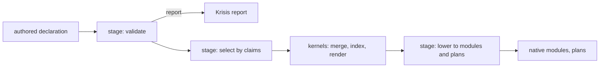

# Functional design in Lexicon

Lexicon is designed from domain values outward, not from Nix syntax inward. Start with what a value
is, its invariants and the operations that consume it. Then pick the construct that expresses that
shape. This page maps the usual functional vocabulary onto the constructs Lexicon uses, and says
what each one costs in Nix.

```nix
let
  inherit (fx.types) Record Variant ListOf String refined;
  RelativePath = refined "RelativePath" String isNormalizedRelative;
  Link = Variant {
    individual = Record { source = String; destination = String; };
    grouped = Record { source = String; names = ListOf RelativePath; destinations = ListOf String; };
  };
in
fx.handle { handlers = fx.effects.typecheck.collecting; state = [ ]; } (Link.validate authored)
```

The snippet is illustrative. `isNormalizedRelative` stands for the path predicate `core` will own.
One description gives the boolean check, the validation with paths to each failure, and the
failure policy, which the handler chooses. Code that consumes a `Link` after this point doesn't
validate it again.

## The vocabulary

| Concept | Construct | Lexicon example |
| --- | --- | --- |
| Product | `fx.types.Record` | A link, a theme record, a subsystem's settings |
| Sum | `fx.types.Variant`, `Either`, `Maybe` | Individual or grouped link, static value or callback |
| Refinement | `fx.types.refined`, `oneOfStr`, `nonEmptyStr` | Normalized path, host name, command name |
| Effect | `fx.send`, `fx.bind`, a handler | Reporting a diagnostic, reading selection context |
| Handler | `fx.handle` with policy | Collect every error, or stop at the first |
| Kernel | A plain Nix function | Claim selection, merge, collision index |
| Combinator | `match`, `fold`, `dispatch` in `core` | Lowering each link variant, walking a declaration |

## Types describe, handlers decide

A type is a description of accepted values. It carries two operations. `T.check` returns a boolean
and is fast. `T.validate` is a computation that sends a `typeCheck` effect at every field, list
index and variant branch, so each failure arrives with the path that broke.

Stages call `validate` under a handler that collects, because users want every error in one pass.
A kernel never validates. Its input type is the proof that validation already happened. When a
kernel needs a guard, such as a branch that depends on a value's shape, it calls `check`.

This is "parse, don't validate" in Nix terms. A stage turns authored input into a value of a known
type, or a report. Everything after that stage trusts the type.

## Kernels and stages



A kernel is where speed lives. It's raw Nix over validated data: no effects, no diagnostics, no
`tryEval`. It throws only when a caller broke its contract, which is a programmer error. Kernels get
the algorithm audit.

A stage is where failure on user input lives. It runs on nix-effects, accumulates independent
diagnostics, and stops dependent work after an invalid parent. Stages are thin. They validate,
call kernels and report.

If a function both computes something hard and reports user errors, it's two functions.

## Combinators

Nix is Turing complete. What it lacks is pattern matching and a type system in the language, so the
same branching shapes get written again and again. `core` owns a small vocabulary that names those
shapes once.

| Combinator | Replaces | What it guarantees |
| --- | --- | --- |
| `match` | An `if`/`else if` chain over a tag | Every constructor of the sum is handled, checked when the matcher is built |
| `fold` | A hand-written recursive walk | One traversal order, and children are visited only when demanded |
| `dispatch` | A chain of `if name == ...` | Unknown names are rejected before lookup, and the table is checked for collisions |

Add a combinator when a branching shape repeats across owners and the combinator can guarantee
something the hand-written version can't. Keep `if` for guards, short-circuits and one-off
decisions. A dispatch table that replaces a clear two-way `if` is worse code.

## Limits

These come from nix-effects itself and from Lexicon's laziness contract. Design around them on
purpose.

- **Effect names are strings, and handlers merge as attribute sets.** If two handlers share a name,
  the last one wins without an error. Lexicon's effects use a `lexicon/` prefix, and a subsystem's
  effect names are registered and checked for collisions.
- **Handler state is deeply forced on every trampoline step.** That breaks thunk chains, but it also
  forces anything put in state. A value that must stay lazy crosses an effect boundary inside a
  thunk carrier (`fx.state.mkThunk`), never as plain state. Tests send throwing values through the
  whole path to prove it.
- **Only the stable public API is allowed.** Records, variants, refinements, effects and handlers
  are stable. nix-effects' `experimental` namespace is off limits. Dependent types and proof terms
  are allowed only for a concrete obligation that a simpler type can't express.
- **Two `fx` instances can meet in one evaluation.** Den pins its own nix-effects, and Lexicon uses
  the corrected copy Krisis ships. A computation built with one instance is never run by the other.
  Lexicon shares one instance through one dependency owner.
- **Validation cost isn't free.** `validate` runs through a typed kernel. It belongs at stage
  boundaries, not inside loops over data that's already valid.

## Diagnostics

Krisis is the diagnostic engine. A subsystem owns a catalog of its codes and supplies authored
locations such as `furnish.links[0].source`. Krisis owns diagnostic records, reports, collection
policy and rendering. Lexicon doesn't wrap Krisis in a compatibility layer. When a subsystem needs
something Krisis doesn't offer, Krisis gains it.

## Further reading

- [nix-effects](https://github.com/kleisli-io/nix-effects), its README and the book chapters on
  typed validation and generic programming.
- Alexis King, [Parse, don't validate](https://lexi-lambda.github.io/blog/2019/11/05/parse-don-t-validate/).
- Den's [effects guide](https://github.com/denful/den/blob/main/docs/src/content/docs/explanation/effects.mdx)
  and its `nix/lib/aspects/fx` pipeline, read at v0.19.0, for handlers at scale.
