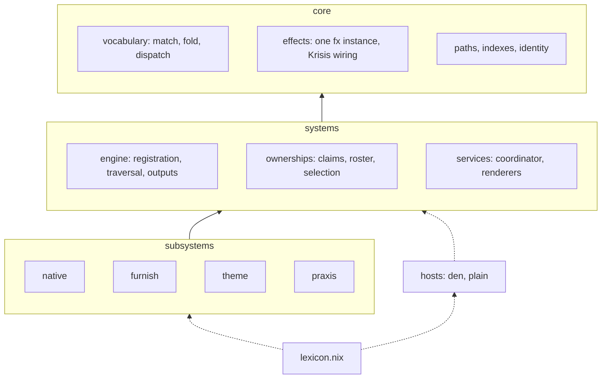

# Lexicon design philosophy

These are the laws for how Lexicon is organised and built. They decide where new code goes, what it
may depend on and how it reports failure. AGENTS.md files turn them into specific rules. A rule
that contradicts a law is wrong, or the law is, and either one changes only on purpose.

The goal is a library that grows by adding subsystems without growing special cases. A user writes
small declarations, and every concern behind them has one owner.

```nix
{ lexicon, ... }:
{
  den.aspects.helix = lexicon {
    package = pkgs: pkgs.helix;
    furnish.files = [{ source = ./config.toml; destination = ".config/helix/config.toml"; }];
    hosts = [ "khion" ];
  };
}
```

That declaration is the product. Everything below exists to keep it this small while the library
underneath grows.

## What Lexicon is

Lexicon composes and compiles. It turns declarations into native modules for module systems such as
NixOS and Home Manager, and into plans that runtime services carry out. Hosts are adapters. Den is
one host, a plain flake is another, and neither one decides Lexicon's shape. Lexicon used without
Den should read as cleanly as Lexicon inside Den.

## The layers

Every module belongs to one layer and depends only on the layers below it. Two modules in the same
layer may depend on each other only through an edge that is declared, and the graph stays acyclic.



A layer is defined by what its modules may assume. Core assumes Nix, nix-effects and Krisis. A
system assumes core. A subsystem assumes the systems. Hosts and the assembly sit outside the stack.
A host binds Lexicon to a composition environment. The assembly composes the enabled subsystems
into the public API. No layer depends on either one.

A module that needs something two layers down gets it from the layer in between. If that layer
doesn't have it, the layer is missing a system, and that system gets built.

## Laws

1. **Lexicon composes and compiles. Hosts are adapters.** Den and plain flakes plug in through one
   host contract. A Den feature Lexicon wants becomes Lexicon's own design, not a dependency on
   Den's internals.
2. **Every concern has one owner, and the path names it.** A subsystem owns its settings, blocks,
   kernels, stages, diagnostic codes, tests and docs. `utils`, `helpers`, `common` and `shared`
   name no responsibility, so nothing goes in a directory with those names.
3. **Layers point down.** A declared same-layer edge is an exception, and a layer that collects
   many of them is missing a level underneath.
4. **Configure with schemas, compile with functions.** Subsystem settings are static schemas folded
   over ordered layers. Declarations are plain values that functions compile. The nixpkgs module
   system appears only as a thin adapter at a host's edge.
5. **Kernels are raw Nix, and stages are effects.** A kernel is a pure algorithm over validated
   data, such as selection, merge, collision detection or rendering. It uses no effects and throws
   only on programmer error. A stage is a pipeline step that can fail on user input. It runs on
   nix-effects and reports through Krisis.
6. **Krisis reports.** Lexicon defines diagnostic codes and authored locations, never its own
   reporters, renderers or collection. When Lexicon needs a diagnostic capability, Krisis gains it
   and the pin moves.
7. **Evaluation is pure, and services act.** A block lowers into a plan, which is data. Runtime
   services such as the coordinator execute plans. Evaluation never reads mutable state or
   performs work through import-from-derivation.
8. **Laziness is part of the contract.** Every operation states what it may force. Inactive
   payloads, native module bodies and unselected outputs stay unforced.
9. **Vocabulary over repetition.** Domain alternatives are tagged sums handled by `match`, trees are
   consumed by folds, and registered names dispatch through tables. A clear one-off `if` stays an
   `if`.
10. **Compatibility lives at one boundary and has an end date.** An adapter for an old API or an old
    dependency sits in one place. It's removed in a reviewed change, never left beside the new path.

## Placing new work

Answer these in order and stop at the first one that settles it.

1. Which subsystem owns the concern? It goes there, even if another one is easier to edit.
2. Does it need a new consumer-facing block, a new runtime service or settings no subsystem owns?
   Then it's a new subsystem, with a subsystem record, a doc and tests in the same change.
3. Its layer is one above the highest layer among its dependencies. If a lower layer will need it,
   write it for that lower layer from the start.
4. Name it for its responsibility.

Subsystems can be large. Composition, discovery and flake management are subsystems the same way
furnish is, and the same laws apply to them.

## Correctness first

Fix a problem in the owner of the broken invariant. A workaround where the symptom shows up hides
the invariant, even when the test passes. A new concern gets a component that owns it, and the old
parallel path is removed in the same change. Get the algorithm and data layout right before
optimizing, and measure before doing anything unusual.

[Functional design](explanation/functional-design.md) explains the vocabulary these laws use.
[The architecture](explanation/architecture.md) describes the target owners and contracts.
