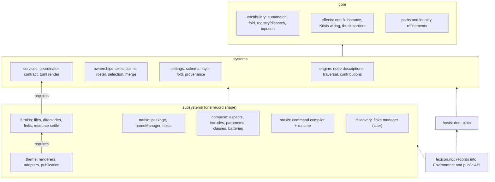
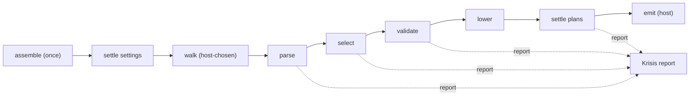

# Lexicon functional architecture proposal

Status: research proposal for the [restructure effort](../../docs/efforts/restructure.md). It
fills in the parts that document leaves open: layer contracts, the subsystem record, the compile
pipeline, extension, settings, composition and the Krisis upgrades. Everything marked
**Assumption** was inferred rather than read in source during this pass.

## 1. The recommendation

Build Lexicon as a **registry-assembled nanopass compiler**. A small `core` gives every owner the
same vocabulary: tagged sums with checked matchers, folds over declaration trees, collision-checked
registries, a topological sort, and the one shared nix-effects instance wired to Krisis. Three
**systems** sit on that core: the engine (registration, traversal, outputs), ownerships
(claims, roster, selection) and settings (schemas folded over layers). **Subsystems** are records
of one shape. Each one contributes vocabulary to a fixed set of extension points (blocks,
annotations, classes, plan kinds, services, surfaces) and never adds a pipeline stage of its own.
The assembly reads the records, checks them once, and freezes them into an `Environment`. The
compiler then runs a fixed sequence of small named stages over that environment. Each stage has one
input shape, one output shape and a stated forcing budget.

Inside a stage, the hard work is a **kernel**: raw Nix over validated data, written against plain
function records (object algebras), with no effects. The stage around it is a thin nix-effects
computation that validates, calls kernels and reports through Krisis. Effects are used for exactly
two things: reporting diagnostics and reading scoped context. They aren't used for traversal,
merge or selection, because every `send` costs a trampoline step that deep-forces handler state.

**Composition** is a subsystem like the others. It owns the aspect model (includes, parametric
bodies, native classes, batteries, exclusion) and exposes a `walk` kernel. A **host** is a record
that tells Lexicon what entity kinds exist, who the principals are, where each native class lands
and which walker to use. The plain host uses Lexicon's walker. The Den host keeps Den's walker,
because skadi's includes, batteries and quirks already run there, and Lexicon compiles each
`lexicon { ... }` value into a Den aspect fragment exactly as today. The aspect syntax is the same
in both. A conformance suite runs the same aspect fixtures through both hosts so the two walkers
can't drift silently.

Settings are static schemas folded over ordered layers, least specific first, with a declared merge
strategy per leaf, positional authority and lazy provenance. The nixpkgs module system appears only
as an edge adapter that turns module definitions into one settings layer.



The compile path for one declaration, which section 4 specifies:



## 2. Layers and allowed dependencies

| Layer | May import | Owns | Must not |
| --- | --- | --- | --- |
| core | Nix builtins, nixpkgs `lib`, nix-effects (stable API), Krisis | vocabulary combinators, the one `fx` instance, thunk carriers, path and name refinements, identity keys | name a subsystem, emit a diagnostic code of its own except programmer-error throws |
| systems | core, and other systems through a declared edge | engine, ownerships, settings, services | import a subsystem or a host |
| subsystems | core, systems, and the **exports** of subsystems in its `requires` closure | blocks, kernels, stages, catalog, tests, docs for its concern | import another subsystem's files by path, or reach a subsystem it didn't declare |
| hosts | core, systems, the host contract | binding Lexicon to Den or a plain flake | import a subsystem; the assembly hands a host the walker it needs |
| assembly | everything | turning records into the `Environment` and the public `lib` | contain domain logic |

Declared same-layer edges today:

- systems: `engine -> ownerships` (traversal applies claims), `engine -> settings` (lower receives
  resolved settings). `services` and `settings` have no system edges.
- subsystems: `theme -> furnish`, `furnish -> services` is a downward import, not an edge.
  `compose -> native` (native classes are the payload compose routes).

The philosophy says a layer that collects many same-layer edges is missing a level. Two system
edges is fine. If a third system starts needing `engine`, split a `systems/model` for the shared
IR shapes underneath.

Hosts sit outside the stack. A host never imports `subsystems/compose`. The assembly builds the
plain host as `hosts.plain { walk = compose.exports.walk; ... }`. That keeps the dependency arrow
in the philosophy diagram (`hosts -.-> systems`) true while letting the plain host use the
composition subsystem.

Enforcement: a nix-unit test reads every `import` path under `core/`, `systems/`, `subsystems/`
and `hosts/` (pure `builtins.readFile` plus a regex over the repo's own source, which is ordinary
eval over tracked files, not IFD) and checks it against this table and the declared edges.

## 3. The subsystem record

A subsystem is a function from a **toolkit** to a record. The toolkit is the same for built-ins and
third parties.

```nix
# toolkit handed to every subsystem
{
  lib, # nixpkgs lib
  core, # vocabulary, paths, identity, carriers
  T, # Krisis admitted validation types (after the upgrades in section 9)
  setting, # settings leaf constructor
  node, # engine node constructors (record, collection, contextual, recordMap, value, native, forOutputs, recursive)
  ownerships, # descriptor and relation constructors
  catalog, # Krisis catalog constructor bound to this subsystem's namespace
  requires, # { <name> = exports; } for the declared requires closure only
}
```

```nix
{ T, setting, node, requires, catalog, ... }:
{
  name = "theme";
  requires = [ "furnish" ];
  settings = {
    renderers = setting {
      type = T.ListOf (T.oneOfStr [ "noctalia" "caelestia" "dms" ]);
      default = [ ];
      merge = "union";
      bind = "environment";
      doc = "Renderers whose runtime publication is installed";
    };
  };
  blocks = [ (import ./block.nix { inherit T node requires; }) ];
  annotations = [ ];
  classes = [ ];
  plans = [ (import ./plan.nix { inherit requires; }) ];
  services = [ (import ./publication.nix) ];
  surfaces = { };
  batteries = { };
  exports = { };
  catalog = catalog (import ./catalog.nix);
  docs = ./reference.md;
}
```

### Fields

| Field | Type | Default | Meaning |
| --- | --- | --- | --- |
| `name` | refined kebab-case string | required | Registry key, catalog namespace, effect prefix `lexicon/<name>/`, settings path |
| `requires` | list of names | `[ ]` | Subsystems whose exports this one may use and whose plans/classes it may emit |
| `settings` | attrset of `setting` leaves (nesting allowed by attrset) | `{ }` | Static schema; `enable` is added by the assembly |
| `blocks` | list of block definitions (contract in [definitions.md](../../src/lexicon/definitions.md)) | `[ ]` | Declaration vocabulary |
| `annotations` | list of ownership descriptors, relations and metadata keys | `[ ]` | Added to the shared annotation registry |
| `classes` | list of `{ name; kind; }` | `[ ]` | Native output channels and the entity kind they compile at |
| `plans` | list of `{ kind; type; settle; after ? [ ]; }` | `[ ]` | Resource plan kinds and their settle kernel |
| `services` | list of `{ name; package ? null; module ? null; consumes; }` | `[ ]` | Runtime owners: packages and native modules attached by hosts |
| `surfaces` | attrset of functions | `{ }` | Public entry points the assembly mounts at `lib.<name>` or `lib.<name>.<surface>` |
| `batteries` | attrset of aspects or aspect functions | `{ }` | Reusable host-neutral aspects |
| `exports` | attrset | `{ }` | Library the `requires` dependents see |
| `catalog` | Krisis catalog | empty | Diagnostic codes this subsystem may emit |
| `docs` | path | none | Reference page; the settings reference is generated from `settings` |

Every field is lazy. A record with only `name` is a valid subsystem.

### Laws

1. **Unique names.** Subsystem names, block names, annotation author keys, metadata keys, class
   names, plan kinds, service names, surface names and catalog namespaces are each unique across the
   assembled set. Registration goes through `core.registry`, never `//` or `listToAttrs`.
2. **Acyclic, satisfied requires.** The requires graph is a DAG over the enabled set. A required
   subsystem that's disabled is an error naming both ends. Lexicon doesn't auto-enable.
3. **Deterministic order.** Subsystems are ordered topologically by `requires`, ties broken by
   authored list order with built-ins first. Every derived order (block traversal, plan settle
   order, diagnostic order) follows from it.
4. **Assembly forces names only.** The assembly forces `name`, `requires`, the names inside each
   vocabulary list, catalog code keys, and the settings schema's structure and merge tags. It doesn't
   force `lower`, `node` bodies beyond their constructor tags, service packages, surfaces or
   batteries.
5. **Visibility follows edges.** A subsystem sees `requires.<name>.exports` only for names in its
   declared closure. Emitting a plan kind or class owned by a subsystem outside the closure is a
   registration error. This turns the declared edge into the only coupling path.
6. **Disabled means absent, but named.** A disabled subsystem registers nothing. Its vocabulary
   names go into a reserved index so an authored `theme = ...` with theme disabled reports "provided
   by disabled subsystem `theme`" instead of a bare unknown field.
7. **Static settings.** A schema is data. Its shape can't depend on a settings value. A schema
   default may be lazy, but the leaf set, types and merge tags are fixed when the record is read.
8. **No new stages.** A subsystem plugs into the fixed extension points. If something truly needs
   a new pipeline position, that's a change to the engine with its own review, not a record field.

### Why one shape scales to product-sized subsystems

The record is an object algebra in the sense of Oliveira and Cook: each field is a constructor
slot of a fixed signature, and the assembly is the interpreter. Praxis is a product: it uses
`surfaces.praxis` (today's `lib.praxis`), `exports` and its Rust runtime as a service. A future
discovery subsystem uses `surfaces.tree` and an `exports.sources` that the plain host's walker
reads. A flake manager uses a block at the new `flake` entity kind (section 7), a service that
provides the `write-flake` app, and settings for the header and formatter. None of these needs a
new field. If one ever does, the field is added once, with a derived default, for all subsystems.

## 4. The compile pipeline

Each stage is named, has an input and output shape, and states what it may force. Shapes are
documented records. Lexicon itself produces every intermediate value, so stages trust their input
and don't revalidate. Tests check the shapes; production code doesn't.

| # | Stage | Kind | Input | Output | May force | Must not force |
| --- | --- | --- | --- | --- | --- | --- |
| 0 | `assemble` | stage, once per configuration | subsystem records, configure layer | `Environment` | see law 4 | lower bodies, surfaces, services |
| 1 | `settle settings` | kernel + stage | schemas, ordered layers | `Settings` with lazy provenance | leaf presence per layer; values only for `append`/`union`/custom leaves when demanded | values of shadowed `replace` contributions |
| 2 | `walk` | host-chosen kernel | aspect roots, host kinds, context | `[Occurrence]` | aspect `name`, `includes` spine, `builtins.functionArgs` of bodies, context keys the bodies request | class payloads, block payloads, claims |
| 3 | `parse` | stage | one occurrence's authored declaration | `Structured` tree, prepared values bound lazily | declaration attr names, annotation values, immediate container shapes, contextual-vs-static discrimination | domain fields, native bodies, sources |
| 4 | `select` | stage over ownerships kernel | `Structured`, context, requested output | `Selected` with `origins`, `metadata`, `prepared` | claims, roster entries, context keys that registered axes request; contextual callbacks after ancestor selection, for the requested projection only | inactive branches, unrequested projections, callbacks of unselected nodes |
| 5 | `validate` | stage | `Selected` | `Valid` (Checked) | selected domain fields to the depth their type requires | `T.Any` fields, native payloads |
| 6 | `lower` | per-block kernel, wrapped by a stage that checks the envelope | `Valid`, block settings, prepared | `Contributions` | whatever `lower` demands | other blocks |
| 7 | `settle plans` | fixed stage over plan-kind kernels | all selected plans for one principal | `Settled` (final resources, service requests, class modules) | destinations (for one collision index), directory inventories of selected directories, theme fields of selected plans | sources of files that don't need inventory, plans of other principals |
| 8 | `emit` | host | `Settled` for the requested class | host value (Den aspect fragment, module list, flake outputs) | only the requested class channel | other channels |

Shapes, written as the record fields each one guarantees:

- `Environment`: `{ subsystems; blocks; annotations; classes; plans; services; catalog; reserved; settings; }`.
  Every collection is a `core.registry` value (`{ order; byName; }`).
- `Occurrence`: `{ identity; context; declaration; origin; }`. `declaration` is the authored value,
  untouched. `identity` is the dedup key (section 7).
- `Structured`: today's `traversal.prepare` result. Record nodes keep authored fields lazy and carry
  a lazily bound `prepared` value per static occurrence.
- `Selected`: requested-projection tree, ownership and metadata fields removed, collection entries
  filtered with `origins` mirroring authored paths.
- `Contributions`: `{ classes = { <class> = [ { module; origin; } ]; }; plans = [ Plan ]; }`, where
  `Plan` is a tagged sum over registered plan kinds. This replaces today's closed
  `{ nixos; homeManager; resources; }` record. The three current names become entries in the class
  and plan registries, so the old shape is one projection of the new one.
- `Settled`: `{ classes; resources; services; }`. `resources` are final Furnish entries with
  principal and origin. `services` lists the service modules the principal needs.

### Plan settle order

`settle plans` stays a fixed owning stage, as definitions.md requires. Its order comes from each
plan kind's `after` list, topologically sorted once at assembly: `theme` before `directory`,
`directory` before `file` and `external-link`. That reproduces the current four-step order exactly
and lets a new plan kind declare where it belongs without becoming a scheduler. In Build Systems à
la Carte terms the plan kinds have static, applicative dependencies, so a topological scheduler is
correct and no dynamic scheduling is needed. Contextual callbacks are the monadic part: they run in
`select`, before any plan exists.

### Diagnostics through the stages

Each stage returns a `Computation (Checked a)`. Independent checks at one level combine with
`validation.all` and accumulate. Dependent work uses `validation.andThen` and is skipped after
`Invalid`. A host runs one `report.run` per (occurrence, projection) and finishes it at its edge:
`k.nix.module` for module-system hosts, the new `report.finish` (section 9) for plain flake
outputs. No stage serializes or deep-forces its output to hand it to the next.

## 5. Extension model

Third parties write the same record built-ins write. `configure` takes records:

```nix
inputs.lexicon.lib.configure {
  subsystems = [ (import ./bookmarks.nix) ];
  settings = { bookmarks.root = ".local/share/bookmarks"; };
}
```

`extensions = [ ... ]` stays as a compatibility alias for one release. An old extension record
(`{ name; blocks; ownership; relations; metadata; }`) is converted to a subsystem record at that one
boundary.

### Add a block

```nix
# bookmarks.nix
{ T, setting, node, requires, catalog, ... }:
{
  name = "bookmarks";
  requires = [ "furnish" ];
  settings.root = setting {
    type = T.String;
    default = ".local/share/bookmarks";
    merge = "replace";
    bind = "host";
    doc = "Home-relative directory that receives bookmark links";
  };
  blocks = [
    {
      name = "bookmarks";
      scope = "user";
      outputs = [ "plans" ];
      node = node.collection {
        contextual = true;
        item = node.record { fields = { source = T.String; name = T.String; }; };
      };
      lower =
        { value, origins, settings, ... }:
        {
          plans = builtins.genList (
            i:
            let entry = builtins.elemAt value i; in
            requires.furnish.exports.plans.externalLink {
              inherit (entry) source;
              destination = "${settings.root}/${entry.name}";
              origin = builtins.elemAt origins i;
            }
          ) (builtins.length value);
        };
    }
  ];
  catalog = catalog { };
}
```

The block gets ownership annotations, metadata, contextual callbacks, origin tracking and the
shared Furnish collision check without writing any of them. That's the existing contract; the only
changes are `requires`, settings injection and plan constructors coming from the required
subsystem's exports instead of a global.

### Add an annotation

An annotation is an ownership descriptor in `annotations`. The descriptor contract (author keys,
value validation, permitted scopes, axis with `top`/`narrow`/`select`, context key) is unchanged
from [definitions.md](../../src/lexicon/definitions.md). It applies to every declared record node
of every block, including built-ins, because traversal reads the frozen annotation registry. A
descriptor that needs roster data the host doesn't provide fails at `select` with a missing-context
diagnostic, as today.

### Add a whole subsystem

A product-sized subsystem uses the remaining fields. A discovery subsystem, sketched to show the
shape holds:

```nix
{ core, ... }:
{
  name = "discovery";
  surfaces.tree = root: core.discovery.tree root; # pure readDir over a source path
  exports.sources = tree: tree.files;
}
```

The plain host's walker accepts `sources` as aspect roots. Nothing else changes.

### Open operations as well as open variants

The expression problem has two sides. Lexicon's open side is variants: blocks, annotations, classes,
plan kinds. Operations over all variants (lowering, docs, settings reference, inspection) come from
the block's `node` description, generically, the way nix-effects derives validation and docs from a
type description. Adding an operation means writing one generic function over node descriptions,
not editing every block. That's how the design gets both sides without type classes: registries
for variants, description-driven derivation for operations.

## 6. Settings DSL

### Schema

```nix
setting {
  type; # Krisis admitted type
  default; # lazy
  merge ? "replace"; # replace | append | union | attrs | { custom = { name; op; identity ? null; }; }
  bind ? "environment"; # environment | host
  doc;
}
```

`bind` is the binding time. An `environment` leaf is fixed when the configuration is assembled. It's
the only kind that can change vocabulary, so `enable` is always `environment`. A `host` leaf can
also be set per host and is resolved per host context. The furnish state path in skadi is a `host`
leaf; the renderer list is an `environment` leaf.

### Layers and the fold

A layer is `{ origin; value; }`. `origin` is a Krisis location (label, source, path). `value` is a
partial record shaped like the schema. Layers are ordered least specific first:

1. schema defaults, origin = the subsystem's record file
2. the configure layer, origin = the `configure` call
3. host layers (for `host` leaves only), origin = whatever the host adapter read

A layer that sets a leaf the schema doesn't declare is an error with a suggestion. A layer that sets
an `environment` leaf from a host layer is an error that names the binding time.

The fold is per leaf, one pass over the layer list, and the strategy decides the operation:

| Strategy | Operation | Algebra | Consequence |
| --- | --- | --- | --- |
| `replace` | last present wins | the "last" semigroup: associative, not commutative | only the last present layer's value is forced |
| `append` | list concatenation in layer order | free monoid, identity `[ ]` | order is layer order |
| `union` | ordered set union, first occurrence kept | idempotent, associative; commutative up to order | duplicates across layers are harmless |
| `attrs` | per-key `replace` over an attrset value | pointwise last semigroup | one key's override doesn't touch siblings |
| custom | `op` folded left to right | none assumed | no reassociation, no parallel or tree fold |

There's no priority override, no `mkForce` equivalent and no per-definition strength. Position
decides. Gen-settings reached the same rule for the same reason and is worth reading for its tests,
though Lexicon won't depend on it.

### Provenance

`Settings` has two parts: `value.<subsystem>.<leaf>` and `explain.<subsystem>.<leaf>`. `explain` is
a list of `{ origin; value; kept; }` entries, one per layer that set the leaf. It's lazy per entry,
so forcing the chain doesn't force shadowed values. A settings error reports the winning origin as
primary and the other contributors as Krisis `related` entries.

### The edge adapter

For a module-system host, the adapter declares one option per `host` leaf at
`lexicon.<subsystem>.<leaf>`, with a custom option type whose merge function returns the list of
`{ file; value; }` definitions instead of merging them. The adapter turns that list into one host
layer. Inside that layer, two different definitions of a `replace` leaf are a conflict diagnostic
naming both files, because module order isn't a meaningful position. Equal definitions are fine.

**Assumption**: nixpkgs discharges `mkIf`/`mkMerge` and filters by override priority before it
calls a type's `merge`, so `mkDefault`/`mkForce` act as module-system filtering before Lexicon sees
the layer. This is from memory of `lib.modules.mergeDefinitions` and must be checked against the
pinned nixpkgs before the adapter is written. If it holds, the adapter documents that behavior; if
the owner wants priorities rejected outright, the adapter can't see them and the option type has to
detect the wrappers itself.

The settings reference page is generated from the schemas, so it can't drift from the code.

## 7. The composition subsystem

### The smallest model that matches Den's ergonomics

An aspect is one of:

- an attrset whose keys are `name`, `includes`, registered native class names, and nothing else;
- a `lexicon { ... }` value: a Lexicon declaration, which may also carry `name` and `includes`;
- a function whose formal arguments are entity kinds (and optionally `...`), returning either of the
  above.

That's it. `includes` forms a DAG. A function body binds by `builtins.functionArgs`, exactly as Den
does. Class payloads are native modules and stay opaque. Inside a native class module, arguments
named after entity kinds are pre-applied and the rest are advertised to the module system with
`lib.setFunctionArgs` (Den's flat-form class module). Lexicon already injects `host` and `user`
into `homeManager` functions; this generalizes it to every class and kind.

### Keep from Den

- Aspects as attrsets keyed by class, so one concern spans NixOS and Home Manager.
- `includes` as the composition edge, with depth-first pre-order and first-occurrence dedup by
  identity (name chain plus context id). Unnamed includes never dedup.
- Context-parametric bodies selected by argument shape, and fan-out from a host-scope body that
  names a descendant kind.
- Flat-form class modules.
- Batteries as plain aspect values or aspect-returning functions.
- A root include list applied at every entity (Den's `den.default`), because skadi uses it for
  `stateVersion`.

### Change

- **Inert vs unknown.** Den makes a body that names an unreachable kind silently inert, because it
  can't tell misplacement from legitimate fan-out without whole-fleet context. Lexicon's walker has
  the host's kind schema, so it can split the case: a formal argument that isn't a kind at all, and
  isn't `...`, is an error at `walk`. A real kind that isn't reachable from the include scope stays
  inert, and the walker records it in an inspection trace so a "why didn't this apply" question has
  an answer.
- **Exclusion is a selection transform.** Today's `denApi.drop` becomes `compose.exports.exclude`,
  a pure includes-to-includes kernel with the same unmatched-name diagnostic, usable by any host.
- **Selection by claims, not just by shape.** A `lexicon { hosts = [ "khion" ]; ... }` declaration
  still uses ownership claims. The walk binds context; `select` applies claims. They compose: shape
  decides where a body can run, claims decide which slices a declaration's blocks reach.
- **Entity kinds come from the host contract**, not from user-written policies. `flake`, `host`,
  `user` and `home` cover skadi. Block `scope` becomes a reference to a registered kind instead of
  the closed `user | system | split` enum, which is what makes a `flake`-scoped block for a future
  flake manager possible without a special case.

### Leave out

- Policies as a general effect language (`resolve`, `route`, `spawn`, `instantiate`, `provide`).
  Topology comes from the host's kind schema. A real need for custom topology is a host feature.
- Quirks and pipes. Many-producers-one-consumer data in Lexicon is a block owned by a subsystem plus
  a collection step in `settle plans`. Under the Den host, skadi's `den.quirks.persistence` keeps
  working because Den still walks.
- `provides` and `_` sub-aspect namespaces, `meta.guard` and `hasAspect` conditional aspects, and
  `__findFile` paths. Named aspects plus claims and `when` cover the uses skadi has. A grep of
  `/etc/skadi/modules` found `provides` only in a comment.

### Context and classes

The host declares kinds as a forest: `{ flake = { }; host = { parent = "flake"; }; user = { parent = "host"; }; home = { parent = "flake"; }; }`.
Class records come from subsystems: `native` registers `nixos` at `host`, `homeManager` at `user`.
`walk` emits occurrences per entity scope; `emit` sends each class channel to the module system the
host maps it to.

### Batteries

Lexicon batteries are host-neutral aspects exported by subsystems, such as `compose.batteries`
versions of `define-user`, `primary-user` and `user-shell` for the plain host. They only touch
classes through the class registry, so they also work as includes under Den. Under Den, skadi keeps
using `den.batteries`; nothing forces a switch.

### The host contract

```nix
{
  name; # "den", "plain"
  kinds; # entity kind forest, as above
  roster; # Ownerships roster built from the host's entities
  principals = { files; userNames; }; # today's filePrincipals and hostUserNames
  classes; # { <class> = { sink; }; } where each native class lands
  walk; # aspect roots -> context -> [Occurrence], or "host" when the host walks itself
  layers; # context -> [settings layer]
  emit; # Settled -> host value
}
```

Den host: `walk = "host"`. `lexicon { ... }` returns a Den aspect fragment (class keys plus
`includes`/`name` passed through), Den walks, and Den calls the fragment's class functions with
`host`/`user`, which run stages 3 to 8 for that slice. That's the current `forDen` behavior with the
include pass-through added. Roster and principals come from today's `src/den.nix`. `mkTarget` and
`hostAspects` stay in the Den host because they reach Den internals.

Plain host: `walk = compose.exports.walk`. The user lists hosts and aspect roots; the host
instantiates `nixosSystem` per host from the emitted class modules and exposes
`nixosConfigurations`.

**Owner decision.** Letting Den walk under the Den host is the recommendation because skadi's
batteries, quirks and include graph run there today. The cost is two walkers. The alternative is to
run Lexicon's walker inside Den and hand Den only leaf modules, which gives one walker but loses Den
batteries and quirks as includes. Either way, a conformance suite of shared aspect fixtures runs
through both hosts and compares demanded projections.

## 8. Core combinator vocabulary

| Combinator | Signature | Law | Nix cost |
| --- | --- | --- | --- |
| `core.sum` | `name -> { <ctor> = type; } -> Sum` | constructors are the only producers inside Lexicon; `Sum.ctor.<c> payload` builds `{ _tag; value; }` | one attrset per sum, built once |
| `Sum.match` | `{ <ctor> = payload: r; } -> value -> r` | **exhaustive and closed**: the handler set's names must equal the constructor names, checked once when the matcher is built; only the selected branch is forced | construction: one sorted `attrNames` comparison, O(k log k); call: one attr select, O(log k) |
| `core.classify` | `[ { tag; guard; } ] -> value -> Tagged` | ordered guards, first match wins, no match is a stage diagnostic; the bridge from untagged authored values (static list or callback) to a tagged sum | one guard call per tried case; guards must be shallow (`isFunction`, `isList`) |
| `core.registry` | `{ what; key; } -> [entry] -> Checked Registry` | no silent overwrite: duplicates are reported with every colliding origin before an index exists; `order` is authored order | one `groupBy`-style pass, O(n log n); never `listToAttrs` before the check |
| `core.dispatch` | `Registry -> name -> entry` | unknown names are rejected before lookup, with a Krisis suggestion in stages and a throw in kernels | O(log n) select |
| `core.fold` | `Algebra -> Node -> r` | catamorphism over node descriptions; one traversal order (record children in sorted name order, collections by index); a child is visited only if the algebra demands it | no extra allocation beyond the algebra's results; laziness makes the visit demand-driven |
| `core.foldWith` | `Algebra -> inherited -> Node -> r` | same as `fold`, plus top-down inherited attributes (path, effective claim, context, origin) | one record per visited node for inherited values |
| `core.unfold` | `{ key; next; } -> roots -> [node]` | anamorphism over a graph via `builtins.genericClosure`: each key visited once, cycles terminate, order is discovery order | iterative, O(V + E) with an O(log V) key check; avoids deep recursion |
| `core.toposort` | `{ key; edges; } -> [node] -> Checked [node]` | Kahn's order with authored-order tie-break; a cycle is reported with its full path | O(V + E) plus attrset indexes |
| `core.foldLayers` | `Strategy -> [layer] -> { value; explain; }` | strategy laws in section 6; custom ops never reassociated | one pass per leaf; provenance entries are thunks |
| `core.meet` | `Axis -> claim -> claim -> claim` | meet-semilattice: associative, commutative, idempotent, `top` is the identity; so ancestor narrowing is order-independent and a child can't widen | per-axis function call |
| `core.carry` / `core.uncarry` | `a -> Thunk a`, `Thunk a -> a` | values that must stay lazy cross effect state only inside carriers | one closure per carried value |

Two kernel-side rules go with the vocabulary:

- Kernels take **algebras** (records of functions), not effects. The ownerships axis record
  (`top`, `narrow`, `observe`, `satisfiable`, `select`) already is one. This is tagless final in
  Nix: a record of operations is the interpretation, and a different record is a different
  interpretation, with no trampoline cost.
- `if` stays for guards, short-circuits and one-off decisions. `match` replaces an `if` chain only
  when the chain encodes a domain vocabulary. Today that's the node-kind chains in
  `src/declarations/traversal.nix` and `definitions.nix`, plan kinds in `lexicon/resources.nix`,
  and the `_con` checks in `effects.nix` (which go away with the Krisis upgrades).

What doesn't transfer from the research, and is dropped on purpose:

- Static exhaustiveness. Nix has no types, so `match` checks at matcher construction, which is the
  earliest point Nix allows. Unreachable-case warnings don't exist.
- Extensible effect rows. nix-effects implements freer monads but not open unions, as its README
  says. Lexicon gets the safety from a prefix convention (`lexicon/<subsystem>/`) and a registry
  check on handler names instead.
- Typed IRs between nanopasses. Lexicon gets the nanopass benefit (small passes, named languages)
  through documented shapes and shape tests, not through a checker on every pass boundary.
- Attribute-grammar evaluators with dependency analysis. Lazy evaluation already gives demand-driven
  attribute evaluation; Lexicon only takes the vocabulary of inherited (top-down: path, claim,
  context) and synthesized (bottom-up: contributions, diagnostics) attributes, which is what
  `foldWith` encodes.

## 9. Required Krisis upgrades

Each item names what Lexicon does today without it, read in this pass.

1. **Code catalogs.** `diagnostic.catalog { namespace; codes = { <code> = { severity; summary; help ? null; }; }; }`
   returning factories per code, rejecting unknown codes at construction, and a
   `catalog.combine [ catalogs ]` that rejects namespace collisions. Today each file calls
   `krisis.mkDiagnosticFactory { codePrefix = ...; }` from the compatibility layer, and nothing
   lists the codes a subsystem may emit. The settings reference generator also wants the catalog to
   render a codes table.
2. **Untagged union admission.** `T.OneOf [ { name; guard; type; } ]`: choose the first branch whose
   shallow guard accepts, validate against that branch, report "expected one of" with branch names
   when none accepts. Authored Lexicon values are untagged (`furnish.files` is a list or a function;
   `homeManager` is a record or a function). `T.Variant` needs `_tag`, so today these go through
   hand-written checks.
3. **`T.AttrsOf` with a key refinement.** Record maps (renderer records, settings `attrs` leaves,
   praxis commands) need a homogeneous attrset type with per-key blame. `T.Record` is closed over
   declared names and `T.Attrs` doesn't inspect values.
4. **`validation.map` and `validation.allAttrs`.** `map` over a Checked value, and an attrset
   counterpart of `validation.all` that accumulates and keeps keys. `effects.nix` uses
   `axiom.validation.map`, and `praxis/fields.nix` hand-rolls `mapChecked`/`map2Checked`.
5. **Path-prefix scoping.** `report.withContext` merges primary-location fields, so an inner path
   replaces the outer one. Stages need `report.withPathPrefix segments computation` so diagnostics
   from a nested stage at `furnish.links[0]` arrive as `furnish.links[0].source` without every
   caller rebuilding the path.
6. **Report replay.** `report.replay report` emits a finished report's diagnostics into the running
   computation, keeping order and visibility, and returns its Checked value. `effects.nix`'s `share`
   hand-rolls this for static checks that are computed once and reported in every slice.
7. **Report finish for non-module hosts.** `report.finish { formatter ? null; } report -> a` returns
   the success value or throws one rendered failure listing every visible diagnostic. Today
   `effects.nix` (`eliminateWith`, `checkedFromReport`) and `diagnostic-compatibility.nix` implement
   this with impossible-constructor throws.
8. **Source positions from attributes.** `path.fromAttrPos attrs name -> location or null`, wrapping
   `builtins.unsafeGetAttrPos` with the null case handled. Settings provenance and authored
   locations both want a source and line, and Krisis's own module example does this by hand.
9. **Duplicate suppression by key** (lower priority). `report.run { dedupe = diagnostic: key; }` so a
   static error reported in each host/user slice appears once in a fleet-wide report. Only needed if
   replay (item 6) leaves duplicates in practice; the audit should measure that first.

Handler-name collision checking across subsystems' own effects isn't a diagnostic capability, so it
lives in `core/effects.nix`, not in Krisis.

## 10. Current files and their new homes

| Current file | New home | Notes |
| --- | --- | --- |
| `src/dependencies.nix` | `core/effects.nix` | Keeps the one `fx` instance from Krisis's qualified source; Axiom and the compatibility merge go |
| `src/effects.nix` | deleted | Its helpers become Krisis items 4, 6 and 7 |
| `src/diagnostic-compatibility.nix` | deleted | Krisis catalog and finish replace it |
| `src/inspection-compatibility.nix` | deleted | Krisis `inspect` already covers it |
| `src/type-compatibility.nix` | deleted | Krisis admitted types plus items 2 and 3 |
| `src/declarations/default.nix` | `systems/engine/compile.nix` | Stages 3 to 6 driver |
| `src/declarations/definitions.nix` | `systems/engine/registration.nix`, `systems/engine/node.nix` | Node constructors become a `core.sum`; registration uses `core.registry` |
| `src/declarations/traversal.nix` | `systems/engine/traversal.nix` | Node-kind chain becomes `Node.match` inside `core.foldWith` |
| `src/declarations/outputs.nix` | `systems/engine/contributions.nix` | Envelope check over class and plan registries |
| `src/declarations/report.nix` | `systems/engine/catalog.nix` | Reporter removed; codes become a Krisis catalog |
| `src/declarations/reference.md` | `systems/engine/reference.md` | |
| `src/lexicon/default.nix` | `lexicon.nix` (configure), `hosts/plain/default.nix` (`forRoster`, `forTarget`, `withResolvers`), `hosts/den/default.nix` (`forDen`) | Bridge logic per output moves to `emit` |
| `src/lexicon/builtins.nix` | `subsystems/native/blocks.nix`, `subsystems/furnish/block.nix`, `subsystems/theme/block.nix` | Each block with its owner |
| `src/lexicon/system.nix` | `subsystems/native/units.nix` | Ownership-unit adapter for `nixos` |
| `src/lexicon/resources.nix` | `subsystems/furnish/settle.nix` | The fixed `settle plans` stage |
| `src/lexicon/links.nix` | `subsystems/furnish/links.nix` | Path checks move to `core/paths.nix` |
| `src/lexicon/runtime.nix` | `subsystems/furnish/emit.nix` | Theme runtime pieces move to theme services |
| `src/lexicon/target.nix` | `hosts/plain/target.nix` | Direct-mode target normalization |
| `src/lexicon/legacy.nix` | `legacy/translate.nix` | |
| `src/lexicon/syntax.md`, `definitions.md`, `reference.md` | `docs/reference/` and `systems/engine/` | Updated for records and `requires` |
| `src/ownerships/default.nix`, `surface.nix`, `resolve.nix` | `systems/ownerships/default.nix` | One public entry |
| `src/ownerships/axes.nix` | `systems/ownerships/axes.nix` | Axis records stay as algebras |
| `src/ownerships/engine.nix` | `systems/ownerships/engine.nix` | Kernel; uses `core.meet` |
| `src/ownerships/merge.nix` | `systems/ownerships/merge.nix` | Kernel |
| `src/ownerships/roster.nix` | `systems/ownerships/roster.nix` | |
| `src/ownerships/matrix.nix` | `systems/ownerships/inspect.nix` | Read-only projection |
| `src/ownerships/import-units.nix` | `systems/ownerships/units.nix` | Moves to discovery once that subsystem exists |
| `src/ownerships/reference.md` | `systems/ownerships/reference.md` | |
| `src/furnish/default.nix`, `core.nix`, `files.nix` | `subsystems/furnish/` | |
| `src/furnish/contract.nix` | `systems/services/coordinator/contract.nix` | Manifest and ledger wire format belong to the service |
| `src/furnish/runtime.nix` | `systems/services/coordinator/module.nix` | Attached by hosts as a service module; already has a module `key` |
| `src/furnish/target.nix` | `core/paths.nix` | Path refinements |
| `src/furnish/reference.md` | `subsystems/furnish/reference.md` | |
| `src/toml/*` | `systems/services/toml/` | Renderer plus `runtime.py` publisher; `lib.toml` stays a surface |
| `src/program/theme/default.nix`, `composition.nix`, `capabilities.nix`, `adapters/*` | `subsystems/theme/` | Adapter catalog becomes a `core.registry` |
| `src/program/theme/composition-runtime.nix`, `matugen-runtime.nix` | `subsystems/theme/services/` | Theme publication services |
| `src/program/theme/reference.md` | `subsystems/theme/reference.md` | |
| `src/program/directories.nix`, `program/fields.nix` | `subsystems/furnish/directories.nix`, `subsystems/furnish/lifecycle.nix` | |
| `src/program.nix`, `program/den.nix`, `direct.nix`, `ownerships.nix`, `program/report.nix`, `program/reference.md` | `legacy/` | Removed in a reviewed change with an end date |
| `src/praxis.nix`, `src/praxis/*.nix` | `subsystems/praxis/` | `lib.praxis` becomes `surfaces.praxis` |
| `src/praxis/adapters.nix` | `subsystems/praxis/parameters.nix` (`fromRoster`), `hosts/den/praxis.nix` (`fromDen`) | Den roster extraction belongs to the Den host |
| `src/praxis/runtime/` | `subsystems/praxis/runtime/` | Rust service unchanged |
| `src/praxis/reference.md` | `subsystems/praxis/reference.md` | |
| `src/den.nix` | `hosts/den/default.nix` (roster, principals, `mkTarget`, `hostAspects`), `subsystems/compose/exclude.nix` (`drop`) | |
| `src/den/reference.md` | `hosts/den/reference.md` | |
| `src/registry.nix`, `src/registry/*` | `subsystems/compose/entities.nix` and `hosts/plain/` | Fleet declaration for the plain host; skadi doesn't use it today (grep found no reference) |
| `src/registry/reference.md` | `subsystems/compose/reference.md` | |

Axiom identity, canonical names and registries (used in `ownerships/axes.nix`, `import-units.nix`,
`registry/*`) move to `core/identity.nix` and `core.registry`.

## 11. Before and after

### A skadi aspect under Den

Before, `modules/editors/helix/default.nix` as it is today:

```nix
{ config, inputs, lexicon, ... }:
{
  den.aspects.helix = lexicon {
    package = pkgs: pkgs.evil-helix;
    furnish.files = { pkgs, ... }: [ { source = ...; destination = ".config/helix/config.toml"; } ];
    theme = { pkgs, ... }: { id = "helix"; output = ".config/helix/themes/reactive.toml"; renderers = { ... }; };
  };
}
```

After: unchanged. The Den host keeps `lexicon` as the injected function.

Where an aspect mixes includes and Lexicon blocks, it gets simpler. Before, from
`modules/desktop/compositors/hyprland/default.nix`:

```nix
den.aspects.hyprland = {
  includes = with den.aspects; [ gtk-theme noctalia wayland fuzzel kitty ];
}
// lexicon {
  package = pkgs: pkgs.pyprland;
  nixos = { pkgs, ... }: [ { value = { ... }; } ];
};
```

After (the old form keeps working):

```nix
den.aspects.hyprland = lexicon {
  includes = with den.aspects; [ gtk-theme noctalia wayland fuzzel kitty ];
  package = pkgs: pkgs.pyprland;
  nixos = { pkgs, ... }: [ { value = { ... }; } ];
};
```

### The same aspect in a standalone flake

```nix
# flake.nix
{
  inputs.nixpkgs.url = "github:NixOS/nixpkgs/nixos-unstable";
  inputs.lexicon.url = "github:feltfomo/lexicon";
  outputs = inputs: inputs.lexicon.lib.flake {
    inherit inputs;
    hosts.x86_64-linux.khion.users.feltfomo = { };
    modules = [ ./modules/editors/helix ./modules/users/feltfomo.nix ];
  };
}
```

```nix
# modules/editors/helix/default.nix
{ inputs, lexicon, ... }:
let
  shared = import ../../shared.nix;
in
{
  aspects.helix = lexicon {
    package = pkgs: pkgs.evil-helix;
    furnish.files = { pkgs, ... }: [ { source = ...; destination = ".config/helix/config.toml"; } ];
    theme = { pkgs, ... }: { id = "helix"; renderers.noctalia.sharedWith = shared.noctaliaCompatibleRenderers; ... };
  };
}
```

The aspect body is identical. The wrapper is `aspects.helix` instead of `den.aspects.helix`. A
module file is a function returning `{ aspects; hosts ? ; settings ? ; }`; files merge by
collision-checked registry, and `aspects` is a lazy fixpoint argument so `includes = [ aspects.x ]`
works. That's not the nixpkgs module system. `config.skadi.theme.noctaliaCompatibleRenderers` is a
flake-parts option skadi defines for itself; a standalone flake closes over a plain import instead,
which is the same thing Den's docs recommend for inputs. **Assumption**: `modules = [ ... ]`
becomes `modules = discovery.tree ./modules` once a discovery subsystem exists.

### Subsystem configuration

Before, `/etc/skadi/outputs.nix`:

```nix
let denApi = inputs.lexicon.lib.den { inherit den; }; in
{
  _module.args = {
    lexicon = inputs.lexicon.lib.lexicon.forDen { inherit den; };
    furnishRuntime = inputs.lexicon.lib.furnishRuntime { };
    inherit denApi;
  };
}
```

and `modules/system/impermanence.nix` imports `furnishRuntime` to set `lexicon.furnish.state`.

After:

```nix
let host = inputs.lexicon.lib.hosts.den { inherit den; }; in
{
  _module.args = {
    lexicon = host.lexicon;
    denApi = host;
  };
}
```

`impermanence.nix` keeps `lexicon.furnish.state = { ... };` as written and drops `furnishRuntime`
from its imports, because the Den host attaches the coordinator service module to every host. That
module already declares `key = "lexicon/furnish/runtime.nix"`, so a leftover explicit import
deduplicates. `lexicon.furnish.state` becomes the edge adapter's view of a `host`-bound settings
leaf. Environment settings, when skadi wants any, go in one place:

```nix
inputs.lexicon.lib.hosts.den {
  inherit den;
  settings.theme.renderers = [ "noctalia" "caelestia" ];
}
```

`lib.lexicon.forDen`, `lib.den` and `lib.furnishRuntime` stay as aliases until a reviewed removal,
so skadi needs no edit on the day the restructure lands.

## 12. Points for the performance audit

Measure first with `NIX_SHOW_STATS=1` on `nixosConfigurations.khion` and on fixture flakes per
subsystem, reusing the instrumentation in `verification/praxis-diagnostic-profile.md`.

1. **Effects per declaration.** Every `send` is a trampoline step that `deepSeq`s handler state.
   Count `typeCheck` and `krisis.emit` sends per declaration and the size of Krisis's state at each
   step. If state grows with diagnostics, cost is quadratic in errors.
2. **Slice multiplication.** Stages 3 to 8 run per (host, user, projection). Measure how much static
   preparation is actually shared across slices and across the Home Manager and NixOS bridges.
3. **Environment rebuilds.** `flake.nix` rebuilds the environment through `(make deps).configure`
   whenever a factory call passes `lib`, `axiom`, `krisis` or `mkCoordinator`. Check that skadi's
   call path hits the shared environment.
4. **Registry construction** at assembly: one pass, O(n log n). Confirm it's computed once.
5. **Walk cost.** `genericClosure` key checks, `functionArgs` per occurrence, dedup map size. Compare
   Lexicon's walker against Den's on the same fixtures.
6. **Settings fold.** Leaves times layers, and whether provenance stays unforced in normal builds.
7. **Collision index.** One index over all selected destinations per principal, not pairwise
   checks. Measure on skadi's full resource set.
8. **Directory inventories.** Inventory cost per selected directory and sharing across users.
9. **Growing attrsets and strings.** Search kernels for `foldl'` with `//` accumulators and repeated
   string appends (O(n²)); `toml/render.nix` and praxis manifest building are the first places to
   look.
10. **Validation placement.** `validate` runs through a typed kernel. Check it isn't running inside
    loops over already-valid data, especially in praxis normalization.

## 13. Open risks and owner decisions

1. **Two walkers under two hosts** (section 7). Recommendation: Den walks under Den; conformance
   fixtures guard drift. The owner picks.
2. **Inert vs error for parametric bodies.** The proposal makes unknown kinds an error and keeps
   unreachable kinds inert. The owner confirms.
3. **Settings binding time and the module-system edge.** The `environment`/`host` split and the
   handling of `mkDefault`/`mkForce` (section 6 assumption) need a ruling.
4. **Disabled required subsystem.** The proposal errors instead of auto-enabling. Auto-enable is
   friendlier but hides a dependency.
5. **Krisis admitted types vs raw `fx.types`.** `functional-design.md` shows `fx.types` validated
   under `fx.effects.typecheck.collecting`. This proposal routes all user-input validation through
   Krisis `validation.check` so every failure is a Krisis diagnostic, which requires upgrades 2 and
   3. Note that `fx.types.Record` is open while Krisis `T.Record` is closed.
6. **Two `fx` instances.** Den pins its own nix-effects. The Den host must hand Den only plain
   values, never Lexicon computations. A test should send a Lexicon computation toward Den and
   expect a clear failure.
7. **Entity kinds as a registry.** Replacing the `user | system | split` scope enum with host kinds
   touches every block definition. `split` becomes "emits at two kinds", which needs its own
   definition in the engine.
8. **Quirk-like collection in standalone use.** There's no standalone equivalent of
   `den.quirks.persistence` until a subsystem owns it. The owner decides whether that's in scope for
   this effort.
9. **Compatibility end dates** for `forDen`, `lib.den`, `furnishRuntime`, `program*` and
   `configure { extensions }`.
10. **Trusted code.** Subsystem records are trusted Nix, as definitions are today. A malicious
    record can misattribute origins or force payloads. That's accepted, not solved.

## 14. Sources

Local, read in this pass:

- Lexicon: `docs/philosophy.md`, `docs/explanation/functional-design.md`, `docs/efforts/restructure.md`,
  `AGENTS.md`, `src/lexicon/syntax.md`, `src/lexicon/definitions.md`, `reference.md`, `flake.nix`,
  `src/dependencies.nix`, `src/effects.nix`, `src/den.nix`, `src/lexicon/default.nix`,
  `src/declarations/default.nix`, `src/ownerships/engine.nix`, `src/ownerships/axes.nix`, file heads
  across `src/`.
- skadi (read only): `/etc/skadi/outputs.nix`, `flake.nix`, `modules/den.nix`,
  `modules/editors/helix/default.nix`, `modules/desktop/compositors/mango/default.nix`,
  `modules/desktop/compositors/hyprland/default.nix`, `modules/system/bootstrap-repos/default.nix`,
  `modules/system/impermanence.nix`, `modules/installer/target.nix`, `modules/hosts/khion/default.nix`,
  `modules/users/feltfomo.nix`, `modules/users/owner.nix`, `modules/flake/inputs.nix`, `modules/flake/praxis.nix`.
- Krisis (`/nix/store/m1mby1jivsmf98g3w5fwxm8m78xgph80-source`): `docs/api.md`, `src/default.nix`.
- nix-effects (vendored in Krisis): `README.md`, `book/src/effects-and-handlers.md`,
  `book/src/typed-validation.md`, `book/src/generic-programming.md`, `src/comp.nix`, `src/state/thunk.nix`.
- Den v0.19.0 (`/nix/store/7pv5ph507f0rhx90g76h26hfcxakwgdr-source`): `AGENTS.md`,
  `docs/src/content/docs/explanation/{core-principles,aspects,parametric,policies,class-modules,library-vs-framework,effects,quirks-and-pipes}.mdx`,
  `modules/aspects/batteries.nix`, `modules/aspects/batteries/{primary-user,define-user,user-shell,hostname,forward}.nix`,
  `nix/lib/aspects/fx/{key-classification,identity}.nix`, `nix/lib/aspects/fx/handlers/check-dedup.nix`.
- vic/import-tree at `eb1b52eaecc57f7c136d07ae8a93e724dfecac46`: `README.md`, `default.nix`.
- denful/flake-file at `5312958b796514b2bf97a0e2c501e9f517f277d9`: `README.md`,
  `modules/options/default.nix`, `modules/write-flake.nix`.
- sini/gen-settings at `509fcb5cbaa41c3c455aa3f992b2d4460b4a5008` and sini/gen-merge at
  `ce193e0139a874298738c7bde95ba343702bfdb7`: `README.md` (patterns only).

Research, and what each means here:

- Gary Bernhardt, [Functional Core, Imperative Shell](https://www.destroyallsoftware.com/screencasts/catalog/functional-core-imperative-shell/) (2012) and
  [Boundaries](https://www.destroyallsoftware.com/talks/boundaries). In Lexicon: kernels and stages
  are the core and return values; services (coordinator, praxis runtime, matugen publication) and
  host module systems are the shell. Evaluation never acts.
- Oleg Kiselyov and Hiromi Ishii, [Freer Monads, More Extensible Effects](https://okmij.org/ftp/Haskell/extensible/more.pdf) (Haskell 2015),
  and Kiselyov, Sabry, Swords, [Extensible Effects](https://okmij.org/ftp/Haskell/extensible/exteff.pdf) (Haskell 2013).
  nix-effects implements the freer monad and FTCQueue but not open unions, so Lexicon uses effects
  for reporting and context only, with a name prefix and registry instead of effect rows.
- Gordon Plotkin and Matija Pretnar, [Handlers of Algebraic Effects](https://homepages.inf.ed.ac.uk/gdp/publications/Effect_Handlers.pdf) (ESOP 2009).
  Handlers as policy: the same stage runs collecting in builds and strict in tests.
- Jacques Carette, Oleg Kiselyov, Chung-chieh Shan, [Finally Tagless, Partially Evaluated](https://okmij.org/ftp/tagless-final/JFP.pdf) (JFP 2009).
  In untyped Nix, tagless final is a record of operations passed to a kernel. Lexicon uses it for
  kernels, where it costs nothing; it drops the typing benefits, which Nix can't express.
- Wouter Swierstra, [Data types à la carte](https://www.cs.ru.nl/~W.Swierstra/Publications/DataTypesALaCarte.pdf) (JFP 2008)
  and Philip Wadler, [The Expression Problem](https://homepages.inf.ed.ac.uk/wadler/papers/expression/expression.txt) (1998).
  Lexicon's answer: registries for new variants, description-driven derivation for new operations.
- Bruno Oliveira and William Cook, [Extensibility for the Masses: Practical Extensibility with Object Algebras](https://www.cs.utexas.edu/~wcook/Drafts/2012/ecoop2012.pdf) (ECOOP 2012).
  The subsystem record is an object algebra over fixed extension points; the assembly interprets it.
- Alexis King, [Parse, don't validate](https://lexi-lambda.github.io/blog/2019/11/05/parse-don-t-validate/) (2019),
  and Yaron Minsky, [Effective ML Revisited](https://blog.janestreet.com/effective-ml-revisited/) (2011), "make illegal states unrepresentable".
  In Nix there's no type to make states unrepresentable, so `parse` turns untagged authored values
  into tagged sums once, constructors are the only producers inside Lexicon, and later stages trust
  the tag.
- Dipanwita Sarkar, Oscar Waddell, R. Kent Dybvig, [A Nanopass Infrastructure for Compiler Education](https://legacy.cs.indiana.edu/~dyb/pubs/nano-jfp.pdf) (ICFP 2004),
  and Andrew Keep and R. Kent Dybvig, [A Nanopass Framework for Commercial Compiler Development](https://doi.org/10.1145/2500365.2500618) (ICFP 2013).
  Small named passes with defined intermediate languages; Lexicon takes the pass discipline and
  documents the languages instead of checking them on every boundary.
- Donald Knuth, [Semantics of Context-Free Languages](https://doi.org/10.1007/BF01692511) (1968).
  Inherited and synthesized attributes; lazy evaluation supplies the evaluator, so only the
  vocabulary transfers, as `foldWith`.
- Erik Meijer, Maarten Fokkinga, Ross Paterson, [Functional Programming with Bananas, Lenses, Envelopes and Barbed Wire](https://maartenfokkinga.github.io/utwente/mmf91m.pdf) (FPCA 1991).
  Catamorphism (`fold` over nodes), anamorphism (`unfold` over includes), and their composition,
  which laziness partly deforests.
- Marc Shapiro et al., [Conflict-free Replicated Data Types](https://inria.hal.science/inria-00609399) (SSS 2011),
  for join-semilattice merge laws, and Brent Yorgey, [Monoids: Theme and Variations](https://ozark.hendrix.edu/~yorgey/pub/monoid-pearl.pdf) (Haskell 2012).
  Basis for the settings strategy table and the claim meet-semilattice.
- Andrey Mokhov, Neil Mitchell, Simon Peyton Jones, [Build Systems à la Carte](https://doi.org/10.1145/3236774) (ICFP 2018).
  Plan kinds have static applicative dependencies, so `settle plans` uses a topological order;
  contextual callbacks are the dynamic part and run earlier. The coordinator's ledger is a
  verifying-trace store at the service layer, not in evaluation.

The URLs for Plotkin and Pretnar, Carette et al., Swierstra, Wadler, Sarkar et al., Knuth,
Meijer et al., Shapiro et al. and Yorgey were not fetched in this pass; they're the publishers' or
authors' usual locations and should be checked before this page is published. The Bernhardt,
Kiselyov, Oliveira and Cook, Keep and Dybvig, Mokhov et al. and Minsky links were confirmed by
search.
